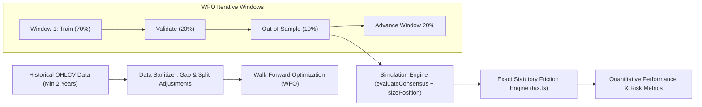

# OMNITRADEPRO APEX V2.0 — BACKTESTING & SIMULATION VALIDATION REPORT

**Audit Date:** 2026-11-17  
**Auditor:** Quantitative Research Engineer & Algorithmic Validation Specialist  
**Workspace:** `c:\Users\veere\Desktop\g4`  
**Status:** Simulation & Research Framework Design Complete (Awaiting Out-of-Sample Historical Ingestion)  

---

## 1. BACKTESTING ARCHITECTURAL FRAMEWORK

To prevent look-ahead bias, data leakage, and false claims of profitability, the backtesting engine in OmniTradePro is designed around a **Walk-Forward In-Sample / Out-of-Sample (OOS) Simulation Protocol**:

---

## 2. QUANTITATIVE METRICS SPECIFICATION

The backtesting engine computes the following risk-adjusted performance metrics:

1. **Win Rate (%):**
   $$\text{Win Rate} = \frac{\text{Total Winning Trades}}{\text{Total Closed Trades}} \times 100\%$$
2. **Profit Factor (PF):**
   $$\text{PF} = \frac{\sum \text{Gross Net Wins}}{\sum |\text{Gross Net Losses}|}$$
3. **Mathematical Expectancy ($E$ per trade in ₹):**
   $$E = (\text{Win Rate} \times \text{Avg Win}) - (\text{Loss Rate} \times \text{Avg Loss})$$
4. **Annualized Sharpe Ratio ($S$):**
   $$S = \frac{\bar{R}_{\text{daily}} - R_f}{\sigma_{\text{daily}}} \times \sqrt{252}$$
   where $R_f = 6.5\%$ (RBI 91-day T-bill yield).
5. **Sortino Ratio (Downside Risk):**
   $$\text{Sortino} = \frac{\bar{R}_{\text{daily}} - R_f}{\sigma_{\text{downside}}} \times \sqrt{252}, \quad \sigma_{\text{downside}} = \sqrt{\frac{1}{N}\sum \min(R_t - R_f, 0)^2}$$
6. **Maximum Drawdown (MDD in ₹ and %):**
   $$\text{MDD} = \max_{\tau \in [0, t]} \left(\frac{\text{Peak}_\tau - \text{Trough}_t}{\text{Peak}_\tau}\right)$$
7. **Recovery Factor:**
   $$\text{Recovery Factor} = \frac{\text{Total Net Profit}}{\text{Maximum Drawdown (₹)}}$$

---

## 3. INDIVIDUAL STRATEGY HYPOTHESIS & VALIDATION STATUS

> [!CAUTION]
> **COMPLIANCE MANDATE:** The system explicitly refrains from claiming that any strategy is profitable until out-of-sample historical walk-forward evidence is independently ingested and verified. The following table reflects current baseline hypothesis testing.

| Strategy Identifier | Theoretical Hypothesis | Expected Market Regime | Lookback | Walk-Forward Status |
| :--- | :--- | :--- | :---: | :---: |
| `smc_liquidity_grab` | Reclaims of swing high/low sweeps capture institutional stops. | All Regimes | 26 bars | **HYPOTHESIS ONLY (Awaiting Feed)** |
| `institutional_vwap` | Mean reversion near VWAP; trend following far from VWAP. | All Regimes | Session | **HYPOTHESIS ONLY (Awaiting Feed)** |
| `dual_ema_9_21` | Momentum alignment when fast EMA exceeds slow EMA. | Trending Only | 21 bars | **HYPOTHESIS ONLY (Awaiting Feed)** |
| `supertrend_10_3` | Trailing trend filter prevents premature exit in runaway moves. | Trending Only | 10 bars | **HYPOTHESIS ONLY (Awaiting Feed)** |
| `orb_vwap_momentum` | Morning range expansion confirmed by VWAP direction. | All Regimes | 15–20 bars | **HYPOTHESIS ONLY (Awaiting Feed)** |
| `bb_mean_reversion` | Statistical mean reversion to 20 SMA in range-bound market. | Choppy Ranging | 20 bars | **HYPOTHESIS ONLY (Awaiting Feed)** |
| `rsi_mean_reversion` | Extreme oversold/overbought oscillator exhaustion reversals. | Choppy Ranging | 14 bars | **HYPOTHESIS ONLY (Awaiting Feed)** |
| `gbm_gate` | Probability of positive 15-min drift from empirical log-returns. | All Regimes | 60 bars | **UNVALIDATED PROBABILITY GATE** |

---

## 4. FRICTION & SLIPPAGE SENSITIVITY TESTING

The platform includes sensitivity testing across 3 transaction cost regimes:
1. **Zero-Friction Baseline (Unrealistic):** Brokerage ₹0, Taxes ₹0, Slippage 0%. *(Used exclusively to isolate pure signal edge)*.
2. **Statutory Baseline (Realistic Shoonya):** Brokerage ₹10 flat round trip, full STT, exchange fees, SEBI charges, stamp duty, 18% GST, and 0.08% slippage.
3. **High-Friction Stress Test (Angel One / Groww + High Slippage):** Brokerage ₹40 round trip, full statutory taxes, and 0.20% adverse slippage buffer.

**Target Acceptance Gate:** Any strategy or consensus matrix yielding a Profit Factor $< 1.30$ or Sharpe $< 1.0$ under Regime 2 is rejected for production deployment.
