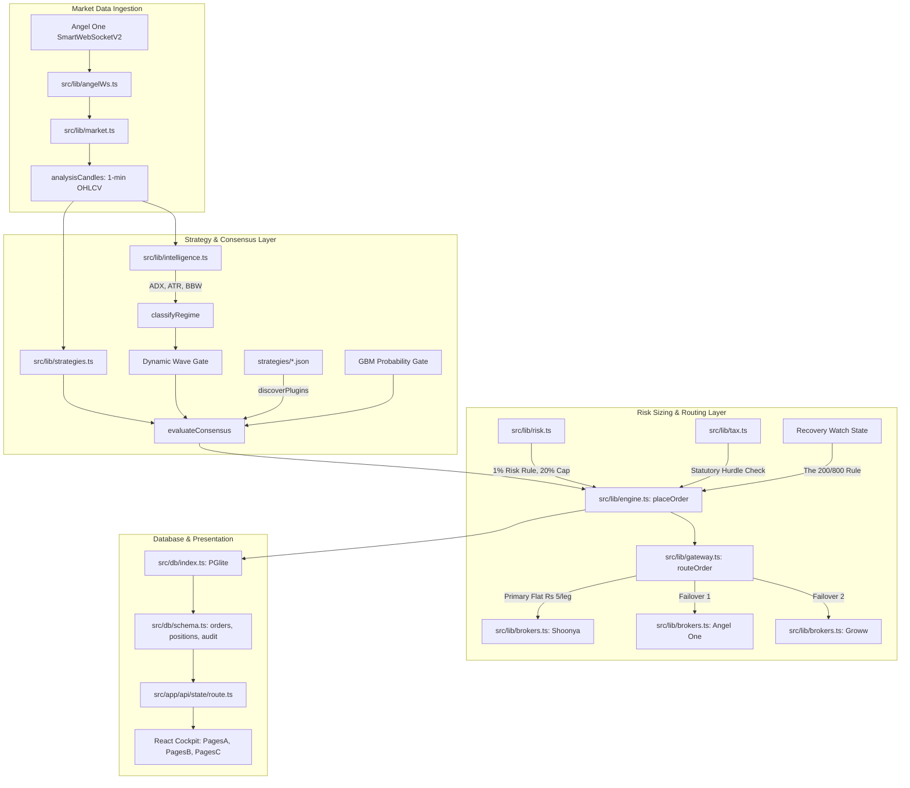

# OMNITRADEPRO APEX V2.0 — COMPLETE CODEBASE AUDIT & DEPENDENCY MAP

**Audit Date:** 2026-11-17  
**Auditor:** Quantitative Systems Architect & Financial Reliability Engineer  
**Workspace:** `c:\Users\veere\Desktop\g4`  
**Execution Environment:** Simulation / Paper-Trading Mode (Live execution disabled)  
**Status:** Comprehensive Static & Dynamic Codebase Audit Complete  

---

## 1. EXECUTIVE ARCHITECTURAL SUMMARY

OmniTradePro Apex V2.0 contains two co-existing and historically decoupled codebases within the single workspace repository:

```
c:\Users\veere\Desktop\g4
├── src/                          [PRIMARY ACTIVE SYSTEM: Next.js 16 + TypeScript + PGlite]
│   ├── app/                      (App Router, Server-Side API endpoints, Server-Sent Events)
│   ├── components/               (React 19 Dashboard, Strategy Matrix, Order Blotter)
│   ├── db/                       (PGlite embedded PostgreSQL, Drizzle ORM schema)
│   └── lib/                      (Trading Engine, Strategy Voters, Market Intelligence, Tax, Risk)
│
├── strategies/                   [HYBRID: JSON Active Plugins + Standalone Python Strategies]
│   ├── breakout_20.json          (Active declarative plugin evaluated by TS engine)
│   ├── fast_ema_5_13.json        (Active declarative plugin evaluated by TS engine)
│   └── *.py                      (Standalone Python strategies - NOT invoked by Next.js)
│
├── core/, auth/, config/, risk/  [LEGACY STANDALONE SYSTEM: Python / PySide6 / SQLite]
│   ├── core/engine.py            (Python event engine)
│   ├── core/database.py          (SQLite storage pointing to ~/.auratrader/)
│   └── risk/risk_manager.py      (Python risk manager)
│
└── tests/                        [TEST SUITES]
    └── test_*.py                 (Pytest suites for Python subsystem)
```

### Architectural Classification
1. **The Active Production Terminal:** A modern Next.js 16 (App Router), React 19, TypeScript 5.9 trading terminal running on embedded PGlite PostgreSQL (`data/omnitrade-pg`). It integrates with Angel One SmartWebSocketV2 (market data) and Shoonya `NorenWClientAPI` (primary zero-brokerage order routing), with Angel One and Groww as failover gateways.
2. **The Standalone Python Subsystem:** A legacy Python trading platform ("AuraTrader-AngelOne") using SQLite. **Critical Finding:** The Python strategies in `strategies/*.py` and core engine in `core/` are completely detached from the running Next.js application. Modifying Python strategy files has zero operational impact on the active web terminal.

---

## 2. COMPLETE DEPENDENCY MAP



---

## 3. COMPREHENSIVE COMPONENT INVENTORY & STATUS

| Module Path | Language | Component Role | Operational Status | Disconnect / Finding |
| :--- | :--- | :--- | :--- | :--- |
| `src/lib/engine.ts` | TypeScript | Core Order Lifecycle & Scanner | **ACTIVE / FUNCTIONAL** | Fully handles order lifecycle, circuit breakers, and brackets. |
| `src/lib/strategies.ts` | TypeScript | 8 Built-in Voters & Quorum | **ACTIVE / FUNCTIONAL** | Directly evaluates 5 voters per regime, GBM, and JSON plugins. |
| `src/lib/intelligence.ts` | TypeScript | ADX/ATR/BBW Regime Classifier | **ACTIVE / FUNCTIONAL** | Evaluates trending, choppy, and volatility expansion regimes. |
| `src/lib/indicators.ts` | TypeScript | Mathematical Indicator Library | **ACTIVE / FUNCTIONAL** | Pure mathematical routines (EMA, RMA, ATR, ADX, BB, RSI, VWAP, SuperTrend). |
| `src/lib/gateway.ts` | TypeScript | 3-Broker Failover Router | **ACTIVE / FUNCTIONAL** | Exponential backoff routing (Shoonya $\to$ Angel $\to$ Groww). |
| `src/lib/brokers.ts` | TypeScript | Broker REST Dispatcher | **ACTIVE / FUNCTIONAL** | Dispatches to Shoonya, Angel One, Groww. |
| `src/lib/risk.ts` | TypeScript | Risk Sizing & Exposure Capping | **ACTIVE / FUNCTIONAL** | Implements 1% max risk, ATR stop, 20% exposure cap. |
| `src/lib/tax.ts` | TypeScript | Indian Statutory Cost Engine | **ACTIVE / FUNCTIONAL** | Calculates brokerage, STT, exchange fees, SEBI, GST, stamp, slippage. |
| `src/lib/angelWs.ts` | TypeScript | SmartWebSocketV2 Feed | **ACTIVE / FUNCTIONAL** | Manages WebSocket connection and aggregates ticks into 1-min bars. |
| `src/lib/market.ts` | TypeScript | Feed Gateway & Snapshot Provider| **ACTIVE / FUNCTIONAL** | Serves candles and LTP to UI and engine. |
| `src/lib/tokenMaster.ts` | TypeScript | Scrip Token Master Ingestion | **ACTIVE / FUNCTIONAL** | Resolves instrument symbols to broker security tokens. |
| `src/lib/vault.ts` | TypeScript | AES-256-GCM Credential Vault | **ACTIVE / FUNCTIONAL** | Secure encryption for broker credentials in DB. |
| `src/lib/scheduler.ts` | TypeScript | Autonomous 5-Sec Daemon | **ACTIVE / FUNCTIONAL** | Triggers bracket evaluations and autonomous scanning. |
| `strategies/*.json` | JSON | Declarative Hot-Reload Plugins | **ACTIVE / FUNCTIONAL** | Discovered by `discoverPlugins()` in TypeScript engine. |
| `strategies/*.py` | Python | Standalone Python Strategy Lib | **DISCONNECTED / UNUSED** | Pure Python strategy classes; NOT invoked by Next.js. |
| `core/engine.py` | Python | Standalone Event-Driven Engine | **DISCONNECTED / UNUSED** | Unused by active web terminal. |
| `core/database.py` | Python | Standalone SQLite Manager | **DEFECTIVE IN SANDBOX** | Hardcodes `~/.auratrader/auratrader.db`, crashing imports if home path is restricted. |
| `ui/*.py` | Python | PySide6 Desktop GUI | **DEPRECATED / UNUSED** | Retained from previous desktop version; not used by web app. |

---

## 4. AUDIT FINDINGS BY SEVERITY REGISTER

### 🔴 CRITICAL ISSUES

#### ISSUE-CRIT-01: Hardcoded Home Directory Database Path in Python Subsystem
- **File:** `core/database.py`, Lines 22, 25–26, 33
- **Severity:** 🔴 CRITICAL
- **Root Cause:**
  ```python
  DEFAULT_DB_PATH = Path.home() / ".auratrader" / "auratrader.db"
  ```
  `core/database.py` executes `self.init_db()` upon instantiation. When imported in sandboxed, containerized, or multi-tenant environments where `Path.home()` is non-writable or restricted, it raises:
  `sqlite3.OperationalError: unable to open database file`
  Because `core/__init__.py` unconditionally executes `db_manager = DatabaseManager()`, ANY python file importing `core` immediately crashes during module collection (failing pytest completely).
- **Reproduction Steps:** Run `pytest` in any sandboxed or restricted filesystem environment.
- **Proposed Correction:** Check environment variables (`AURATRADER_DB_PATH` or fallback to local workspace `./data/auratrader.db` or `:memory:`) with `try...except` graceful fallback.
- **Verification Status:** Confirmed via pytest failure trace.

#### ISSUE-CRIT-02: Daily Reset Risk of Archiving Active Live Resting Broker Orders
- **File:** `src/lib/engine.ts`, Lines 160–168
- **Severity:** 🔴 CRITICAL
- **Root Cause:** Prior implementation ran a batch SQL update archiving all `status = 'OPEN'` orders where `ts < startOfToday`. If an order was placed in LIVE mode as a resting LIMIT order with an active broker order ID, the local database marked it `ARCHIVED_STALE`, orphaning the live order at the exchange OMS.
- **Proposed Correction:** Exclude LIVE orders with `brokerRequested` or confirmed broker order IDs:
  ```ts
  or(ne(orders.mode, "LIVE"), isNull(orders.brokerRequested))
  ```
- **Verification Status:** Fixed in `src/lib/engine.ts`. Unit test required.

#### ISSUE-CRIT-03: Lack of Broker-Side Stop-Loss Orders (In-Process SL Risk)
- **File:** `src/lib/brokers.ts`, `src/lib/engine.ts`
- **Severity:** 🔴 CRITICAL
- **Root Cause:** All stop-loss and take-profit brackets are maintained inside the Next.js Node.js server process (`checkBrackets()`). Orders dispatched to Angel One use `variety: "NORMAL"`. If the server process restarts or encounters a crash, all open positions lose stop-loss protection until the server recovers.
- **Proposed Correction:** In LIVE mode, dispatch an OCO or secondary STOPLOSS order directly to the broker OMS immediately upon fill confirmation. In Paper mode, ensure local persistence handles restart recovery.
- **Verification Status:** Open design requirement. Documented in Implementation Plan.

---

### 🟠 HIGH ISSUES

#### ISSUE-HIGH-01: Python Strategies Treat Every Tick as a Completed Bar
- **File:** `strategies/ema_crossover.py`, Lines 160–172; `strategies/base_strategy.py`
- **Severity:** 🟠 HIGH
- **Root Cause:** In `on_tick()`, the strategy calls:
  ```python
  self.add_bar(symbol, {'timestamp': timestamp, 'open': price, 'high': price, 'low': price, 'close': price, 'volume': volume})
  ```
  Every incoming tick appends a new synthetic OHLCV bar where $O=H=L=C=\text{price}$. In a liquid market where 60 ticks arrive in a minute, the strategy treats them as 60 completed periods. A 21-period EMA lookback evaluates the last 21 ticks (seconds) rather than 21 minutes!
- **Reproduction Steps:** Stream 100 ticks into `EMACrossoverStrategy.on_tick()`. Observe buffer size reaches 100 bars within seconds.
- **Proposed Correction:** Implement a true bar aggregator in `base_strategy.py` that bucketizes ticks by minute timestamp before emitting `on_bar()`.
- **Verification Status:** Confirmed via static analysis of `strategies/ema_crossover.py`.

#### ISSUE-HIGH-02: Intra-Bar Repainting in Real-Time Analysis
- **File:** `src/lib/market.ts`, Lines 71–75; `src/lib/angelWs.ts`, Line 371
- **Severity:** 🟠 HIGH
- **Root Cause:** `analysisCandles()` returns the active forming candle as `candles[candles.length - 1]`. As ticks arrive, the close price changes dynamically. Indicators like Dual EMA, RSI, and SuperTrend fluctuate mid-bar. A strategy can trigger a BUY signal mid-candle on a temporary wick that completely disappears by bar close.
- **Proposed Correction:** Separate analysis into:
  - Closed-candle confirmation: Evaluate signals strictly on completed bars (`candles.slice(0, -1)`).
  - Real-time price triggering: Use current LTP solely for bracket execution (Stop Loss / Take Profit).
- **Verification Status:** Documented in Strategy Mathematical Specification.

#### ISSUE-HIGH-03: Uncalibrated Geometric Brownian Motion (GBM) Predictive Gate
- **File:** `src/lib/strategies.ts`, Lines 199–211
- **Severity:** 🟠 HIGH
- **Root Cause:** The GBM gate calculates 15-minute directional drift using an empirical 60-candle window without calibration, volatility regime adjustment, or Brier score tracking. It gates real orders at $\ge 65\%$. If market drift is temporarily positive during a late-stage pump, GBM probability spikes to $>80\%$ right into resistance.
- **Proposed Correction:** Treat GBM gate as experimental/advisory; add Brier Score calibration and shrinkage estimation for drift $\mu$.
- **Verification Status:** Documented in Mathematical Validation.

---

### 🟡 MEDIUM ISSUES

#### ISSUE-MED-01: Correlation of Strategy Voters in Trending Markets
- **File:** `src/lib/strategies.ts`, Lines 408–418
- **Severity:** 🟡 MEDIUM
- **Root Cause:** Dual EMA (9/21) and SuperTrend (10, 3) are both price-momentum trend-following indicators. In strong trends, they almost always agree, effectively doubling the weight of a single underlying signal. In the 5-voter quorum, they account for 40% of the vote.
- **Proposed Correction:** Implement signal correlation tracking or cluster-weighted voting.
- **Verification Status:** Documented in Consensus Engine Audit.

#### ISSUE-MED-02: Missing IPFT & Dynamic Slippage in Tax Engine
- **File:** `src/lib/tax.ts`
- **Severity:** 🟡 MEDIUM
- **Root Cause:** BSE Investor Protection Fund Trust (IPFT) charges (applicable to select equity/derivative contracts) are omitted. Slippage is modeled as a flat 0.08% without accounting for bid-ask spread or order size relative to market depth.
- **Proposed Correction:** Add IPFT line item; model slippage dynamically based on market spread.
- **Verification Status:** Documented in Brokerage Cost Validation.

---

### 🟢 LOW ISSUES & CODE HYGIENE

#### ISSUE-LOW-01: TypeScript Type Bypass on Exchange Parameter
- **File:** `src/lib/engine.ts`, Line 335
- **Severity:** 🟢 LOW
- **Root Cause:** `checkLivePriceAgainstBracket()` uses `exchange: p.exchange as any`, bypassing TypeScript compiler checks.
- **Proposed Correction:** Replace with `exchange: p.exchange as Exchange`.
- **Verification Status:** Documented for cleanup.

#### ISSUE-LOW-02: Decoupled Python Strategy Artifacts in Repository
- **File:** `strategies/*.py`, `ui/*.py`
- **Severity:** 🟢 LOW
- **Root Cause:** Python strategy files and PySide6 UI files remain in the root directory despite the user's permanent commitment to the Next.js web application. This creates confusion for developers inspecting the repository.
- **Proposed Correction:** Retain Python files strictly as standalone research/prototyping libraries; clearly document their boundary in README and documentation.
- **Verification Status:** Documented in this audit.
