# OMNITRADEPRO APEX V2.0 — EXECUTION & SOFTWARE RELIABILITY AUDIT

**Audit Date:** 2026-11-17  
**Auditor:** Quantitative Systems Architect & Software Reliability Engineer  
**Workspace:** `c:\Users\veere\Desktop\g4`  
**Target Modules:** `src/lib/engine.ts`, `src/lib/gateway.ts`, `src/lib/angelWs.ts`, `src/lib/brokers.ts`  

---

## 1. ORDER LIFECYCLE & STATE MACHINE AUDIT

The order state machine transitions across 6 discrete states recorded in the PostgreSQL `orders` table:

```mermaid
stateDiagram-v2
    [*] --> SUBMITTED: placeOrder() invoked
    SUBMITTED --> REJECTED: Failed PreFlight / Quorum / Risk / Circuit
    SUBMITTED --> OPEN: Limit order resting in paper book or broker OMS
    SUBMITTED --> FILLED: Market order filled immediately on live tick
    OPEN --> FILLING: Live LTP crosses Limit Price
    FILLING --> FILLED: Route confirmed and position created
    OPEN --> CANCELLED: Operator or Circuit Breaker cancel
    OPEN --> ARCHIVED_STALE: Daily reset (Paper only; Live preserved)
    FILLED --> [*]
    REJECTED --> [*]
    CANCELLED --> [*]
```



---

## 2. SYSTEM RESILIENCY & FAILURE MODE ANALYSIS

### 2.1 Duplicate Order Prevention & Symbol Locking
- **In-Memory Lock:** `g.__omniPendingSymbols` tracks symbols with pending working orders.
- **Database Position Check (`src/lib/engine.ts`, Line 926):**
  ```ts
  if (open.some((p) => p.symbol === inst.symbol)) {
    return reject("DUPLICATE_POSITION", `Open position already exists in ${inst.symbol}`);
  }
  ```
- **Tick-Level Mutex:** `g.__omniTickLocks` locks symbol execution during active tick processing to prevent concurrent tick handler overlap.

### 2.2 Crash Asset Protection Lock (WebSocket Disconnection)
- **Monitoring Function:** `getCrashProtectionStatus()` checks `getWsStatus().connected`.
- **Behavior during Disconnection:**
  1. Autonomous scanning halts immediately (`scanAndTrade()` returns 0 scans).
  2. Order entry is blocked: returns `REJECTED_CRASH_PROTECTION`.
  3. Active bracket evaluation (`checkBrackets()`) is **LOCKED**.
  4. Prevents dumping assets or firing market orders into a blank/stale market feed during an exchange or internet outage.

### 2.3 3-Broker Failover Gateway Router (`src/lib/gateway.ts`)
- **Timeout Management:** Each broker attempt has a strict 5,000ms timeout (`ATTEMPT_TIMEOUT_MS = 5_000`).
- **Exponential Backoff:** Retries up to 2 times for retryable 5xx/429 errors (200ms, 400ms).
- **Automatic Fallback Chain:**
  $$\text{Primary: Shoonya (₹5/leg)} \xrightarrow[\text{failure}]{\text{5000ms}} \text{Angel One} \xrightarrow[\text{failure}]{\text{5000ms}} \text{Groww}$$
- **Audit Logging:** Every routing hop and latency measurement is logged to the `audit_logs` table.

### 2.4 Daily Reset & Position Preservation (Issue-CRIT-02 Fix)
- **Enforcement (`src/lib/engine.ts`, Lines 160–168):**
  Only prior-day orders matching:
  `and(eq(orders.status, "OPEN"), lt(orders.ts, startOfToday), or(ne(orders.mode, "LIVE"), isNull(orders.brokerRequested)))`
  are marked `ARCHIVED_STALE`.
- **Live Order Safety:** Live orders with confirmed broker order IDs are preserved for manual operator reconciliation.

---

## 3. POSITION RECONCILIATION AUDIT

### Current Limitation:
The current `openPositionsLive()` reads from local PostgreSQL (`db.select().from(positions).where(eq(positions.status, "OPEN"))`). While robust for paper trading, in live trading a network disconnect between local server and broker could result in a fill at the exchange that the local server missed.
- **Recommended Architecture:** Implement periodic 30-second REST poll to `fetchBrokerPositions()` and compare local versus exchange positions, raising an alarm if quantity or symbol mismatch occurs.
