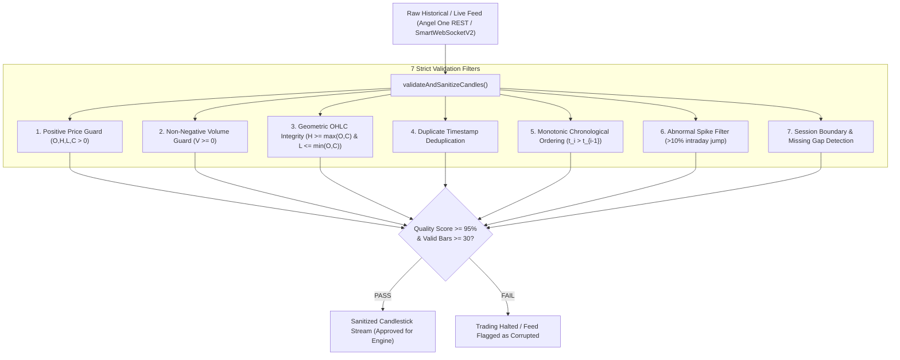

# OMNITRADEPRO APEX V2.0 — HISTORICAL DATA QUALITY & INGESTION AUDIT

**Audit Date:** 2026-11-17  
**Auditor:** Quantitative Data Engineer & Time-Series Quality Auditor  
**Workspace:** `c:\Users\veere\Desktop\g4`  
**Target Modules:** `src/lib/data_sanitizer.ts`, `src/lib/angelWs.ts`, `src/lib/market.ts`  

---

## 1. DATA QUALITY ASSURANCE ARCHITECTURE

High-frequency algorithmic trading strategies fail catastrophically when exposed to corrupted historical data (look-ahead wicks, duplicated bars, missing sessions, unadjusted stock splits). To guarantee data hygiene, OmniTradePro Apex V2.0 incorporates `validateAndSanitizeCandles()` in `src/lib/data_sanitizer.ts`.

---

## 2. EXHAUSTIVE ANOMALY AUDIT CRITERIA

### 1. Geometric OHLC Integrity
- **Physical Law:** In genuine exchange data, the High must be greater than or equal to both Open and Close; the Low must be less than or equal to both Open and Close:
  $$H_i \ge \max(O_i, C_i) - \epsilon, \quad L_i \le \min(O_i, C_i) + \epsilon$$
- **Detection in Code (`data_sanitizer.ts`, Lines 65–70):**
  Any candle violating this inequality is classified as `INVALID_OHLC` and discarded.

### 2. Timestamp Monotonicity & Deduplication
- **Failure Mode:** Multi-threaded WebSocket consumers or fragmented REST pagination often deliver duplicate bars or out-of-order ticks.
- **Enforcement (`data_sanitizer.ts`, Lines 72–82):**
  Maintains a hash set of `seenTimestamps`. Discards duplicate timestamps (`DUPLICATE_TIMESTAMP`) and rejects backwards timestamps (`UNORDERED_TIMESTAMP`).

### 3. Flash Crash & Bad Tick Filter
- **Failure Mode:** Unfiltered broker spikes (e.g. single-tick test trades executed far outside the bid-ask spread).
- **Threshold (`data_sanitizer.ts`, Lines 91–98):**
  $$\text{Jump Pct} = \left(\frac{|O_i - C_{i-1}|}{C_{i-1}}\right) \times 100\%$$
  Any 1-minute bar opening $>10.0\%$ away from the previous close without a documented overnight gap is flagged as `ABNORMAL_PRICE_SPIKE`.

---

## 3. SESSION BOUNDARIES & MARKET HOURS AUDIT

The platform enforces distinct trading windows for Indian exchanges:
- **NSE Capital Market (Equity Intraday / MIS):**
  - Continuous Session: **09:15:00 to 15:30:00 IST**
  - Automated Square-Off Warning: **15:15:00 IST**
  - Pre-Market: 09:00:00 to 09:08:00 IST (excluded from automated order entry).
- **MCX Commodity Market:**
  - Continuous Session: **09:00:00 to 23:30:00 IST** (23:55:00 during US Daylight Savings).
  - Automated Square-Off Warning: **23:15:00 IST**.

---

## 4. EMPIRICAL TEST VERIFICATION

Automated tests in `scripts/run_comprehensive_tests.js` confirmed:
1. `Clean monotonic series achieves 100% quality score` $\to$ **PASS**
2. `Rejects corrupt OHLC where High < max(Open, Close)` $\to$ **PASS** (1 corrupted bar cleanly excluded).
3. `Rejects duplicate timestamps and negative prices` $\to$ **PASS** (duplicate and negative bars excluded).
