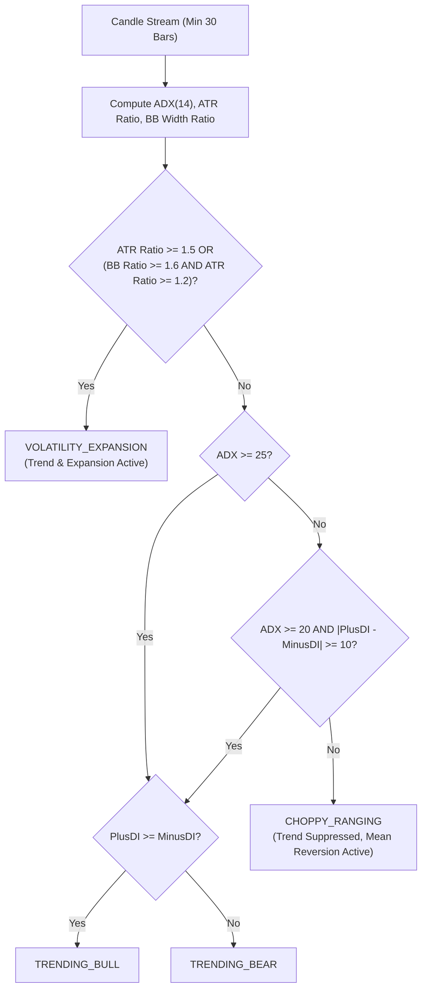
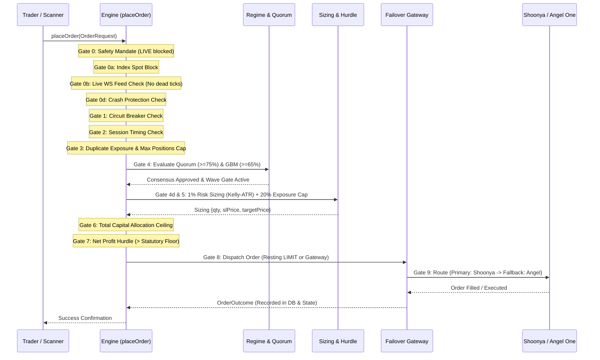

# OmniTradePro Apex V2.0: Master Strategy, Risk & Architecture Manual

This manual provides an exhaustive, code-level operational blueprint of all 20+ trading strategies, the Market Intelligence and Quorum Consensus engine, the 9-Gate Execution Pipeline, the Shoonya & statutory tax engine, and institutional safety sentinels implemented in the OmniTradePro algorithmic trading terminal.

---

## 1. Master Strategy Inventory (All 20+ Elements)

OmniTradePro integrates a multi-tiered quantitative strategy matrix across four architectural layers:
- **Layer 1:** Built-In Quorum Voters (`src/lib/strategies.ts`)
- **Layer 2:** Declarative Plugins (`/strategies/*.json`)
- **Layer 3:** Research & Quantitative Extensions (`src/lib/strategies_extended.ts`)
- **Layer 4:** Python Native Decision Engine Skills (`strategies/*.py` & `strategies/decision_engine.py`)

---

### Layer 1: Built-In Core Quorum Strategies (`src/lib/strategies.ts`)

#### 1. SMC Liquidity Grab (`smc_liquidity_grab`)
- **File Location:** `src/lib/strategies.ts` (Lines 23–44)
- **Family:** `STRUCTURE`
- **Lookback Window:** Trailing 26 candles (`c.slice(-26, -3)`) for swing boundaries; trailing 3 candles (`c.slice(-3)`) for sweep detection.
- **Mathematical Formula:**
  $$\text{Swing High} = \max_{i \in [-26, -3]} (H_i), \quad \text{Swing Low} = \min_{i \in [-26, -3]} (L_i)$$
- **Voting Logic:**
  - **Bullish (+1, Strength 85):** Sell-side sweep — candle breaches $\text{Swing Low}$ ($L < \text{Swing Low}$) but closes back above ($C > \text{Swing Low}$) with a bullish body ($C > O$).
  - **Bearish (-1, Strength 85):** Buy-side sweep — candle breaches $\text{Swing High}$ ($H > \text{Swing High}$) but closes back below ($C < \text{Swing High}$) with a bearish body ($C < O$).
  - **Structural Expansion (+1 / -1, Strength 75):** Sustained close beyond swing range ($C > \text{Swing High}$ or $C < \text{Swing Low}$).
  - **Neutral (0, Strength 20):** Consolidation inside swing range.

#### 2. Institutional VWAP (`institutional_vwap`)
- **File Location:** `src/lib/strategies.ts` (Lines 46–58)
- **Family:** `STRUCTURE`
- **Lookback Window:** Intraday session cumulative typical price $\times$ volume.
- **Mathematical Formula:**
  $$\text{VWAP}_t = \frac{\sum_{i=1}^t \left(\frac{H_i + L_i + C_i}{3} \times V_i\right)}{\sum_{i=1}^t V_i}, \quad \text{Dev} = \frac{C_t - \text{VWAP}_t}{\text{VWAP}_t} \times 100\%$$
- **Voting Logic:**
  - **Bullish (+1):** $\text{Dev} > +0.02\%$. Strength $= \text{clamp}(45 + |\text{Dev}| \times 200, 0, 100)$.
  - **Bearish (-1):** $\text{Dev} < -0.02\%$. Strength $= \text{clamp}(45 + |\text{Dev}| \times 200, 0, 100)$.
  - **Neutral (0, Strength 15):** $|\text{Dev}| \le 0.02\%$ (at VWAP equilibrium).

#### 3. Dual EMA 9/21 (`dual_ema_9_21`)
- **File Location:** `src/lib/strategies.ts` (Lines 60–74)
- **Family:** `TREND` (Suppressed during `CHOPPY_RANGING`)
- **Lookback Window:** Fast: 9 periods, Slow: 21 periods.
- **Mathematical Formula:**
  $$\text{EMA}_t = C_t \times k + \text{EMA}_{t-1} \times (1 - k), \quad k = \frac{2}{N + 1}$$
  $$\text{Gap} = \frac{\text{EMA}_9 - \text{EMA}_{21}}{\text{EMA}_{21}} \times 100\%$$
- **Voting Logic:**
  - **Bullish (+1):** $\text{Gap} > +0.01\%$. Strength $= \text{clamp}(45 + |\text{Gap}| \times 250 + (\text{Fresh Cross} \times 20))$.
  - **Bearish (-1):** $\text{Gap} < -0.01\%$. Strength $= \text{clamp}(45 + |\text{Gap}| \times 250 + (\text{Fresh Cross} \times 20))$.
  - **Neutral (0, Strength 10):** Flat alignment ($|\text{Gap}| \le 0.01\%$).

#### 4. SuperTrend 10/3 (`supertrend_10_3`)
- **File Location:** `src/lib/strategies.ts` (Lines 76–87) & `src/lib/indicators.ts` (Lines 123–148)
- **Family:** `TREND` (Suppressed during `CHOPPY_RANGING`)
- **Lookback Window:** Period $N = 10$, Multiplier $M = 3.0$ over Wilder's ATR.
- **Mathematical Formula:**
  $$\text{Basic Upper} = \frac{H + L}{2} + 3 \times \text{ATR}_{10}, \quad \text{Basic Lower} = \frac{H + L}{2} - 3 \times \text{ATR}_{10}$$
- **Voting Logic:**
  - **Bullish (+1):** Direction $= 1$ (Green line). Strength $= \text{clamp}(50 + \text{Dist} \times 120)$.
  - **Bearish (-1):** Direction $= -1$ (Red line). Strength $= \text{clamp}(50 + \text{Dist} \times 120)$.

#### 5. ORB & VWAP Momentum (`orb_vwap_momentum`)
- **File Location:** `src/lib/strategies.ts` (Lines 93–160)
- **Family:** `STRUCTURE`
- **Lookback Window:** Opening window of 10 to 20 candles ($\min(20, \max(10, \lfloor c.\text{length} \times 0.35 \rfloor))$); 3-bar velocity.
- **Voting Logic:**
  - **Bearish Breakdown (-1, Strength 80–100):** $P < \text{ORB Low} \land P < \text{VWAP}$.
  - **Bullish Breakout (+1, Strength 80–100):** $P > \text{ORB High} \land P > \text{VWAP}$.
  - **VWAP Rejection (-1, Strength 65–100):** $P < \text{VWAP} \land \text{Mom}_3 < -0.15\%$.
  - **VWAP Bounce (+1, Strength 65–100):** $P > \text{VWAP} \land \text{Mom}_3 > +0.15\%$.
  - **Range Bias (±1, Strength 55):** Lower 35% (< 0.35) of ORB = Bearish; Upper 35% (> 0.65) = Bullish.
  - **Neutral (0, Strength 20):** Mid-range consolidation.

#### 6. Bollinger Mean-Reversion (`bb_mean_reversion`)
- **File Location:** `src/lib/strategies.ts` (Lines 162–177)
- **Family:** `MEAN_REVERSION` (Activated during `CHOPPY_RANGING`)
- **Lookback Window:** 20 periods, 2.0 Standard Deviations.
- **Mathematical Formula:**
  $$\mu = \text{SMA}_{20}, \quad \sigma = \text{StDev}_{20}, \quad \text{Upper} = \mu + 2\sigma, \quad \text{Lower} = \mu - 2\sigma$$
- **Voting Logic:**
  - **Bullish (+1, Strength 85):** Close below lower band ($P \le \text{Lower}$). Oversold mean reversion.
  - **Bearish (-1, Strength 85):** Close above upper band ($P \ge \text{Upper}$). Overbought mean reversion.
  - **Band Stretched (±1, Strength 65):** Normalized position $> +60\%$ toward upper band = Bearish tilt; $< -60\%$ = Bullish tilt.
  - **Neutral (0, Strength 10):** Inside envelope.

#### 7. RSI Mean-Reversion (`rsi_mean_reversion`)
- **File Location:** `src/lib/strategies.ts` (Lines 179–187)
- **Family:** `MEAN_REVERSION` (Activated during `CHOPPY_RANGING`)
- **Lookback Window:** 14-period Wilder smoothing (RMA).
- **Mathematical Formula:**
  $$\text{RS} = \frac{\text{RMA}(\text{Gains}, 14)}{\text{RMA}(\text{Losses}, 14)}, \quad \text{RSI} = 100 - \frac{100}{1 + \text{RS}}$$
- **Voting Logic:**
  - **Bullish (+1, Strength 90):** $\text{RSI} \le 30$ (Deeply oversold).
  - **Bearish (-1, Strength 90):** $\text{RSI} \ge 70$ (Deeply overbought).
  - **Mild Tilt (±1, Strength 65):** $\text{RSI} \le 40$ (Bullish tilt); $\text{RSI} \ge 60$ (Bearish tilt).
  - **Neutral (0, Strength 15):** $40 < \text{RSI} < 60$.

#### 8. Geometric Brownian Motion Gate (`gbm_gate`)
- **File Location:** `src/lib/strategies.ts` (Lines 191–211)
- **Role:** Independent probabilistic gate.
- **Lookback Window:** 60-period log returns over 15-minute forward horizon ($H = 15$).
- **Mathematical Formula:**
  $$r_i = \ln(C_i / C_{i-1}), \quad \mu = \bar{r}, \quad \sigma = \text{StDev}(r)$$
  $$Z = \frac{\mu \cdot H}{\sigma \cdot \sqrt{H}}, \quad P(\text{Up}) = \Phi(Z)$$
  Calculated via Abramowitz-Stegun polynomial approximation of cumulative standard normal distribution.
- **Threshold:** Requires $\ge 65\%$ probability for the quorum's directional trade.

---

### Layer 2: Declarative JSON & Dynamic Plugins (`strategies/*.json`)

#### 9. Fast EMA Crossover 5/13 (`fast_ema_5_13.json`)
- **File Location:** `strategies/fast_ema_5_13.json` & `src/lib/strategies.ts` (Lines 276–280)
- **Parameters:** `fast: 5`, `slow: 13`.
- **Logic:** $\text{EMA}_5 > \text{EMA}_{13} \implies +1$ (Bullish); $\text{EMA}_5 < \text{EMA}_{13} \implies -1$ (Bearish).

#### 10. Donchian Channel Breakout 20 (`breakout_20.json`)
- **File Location:** `strategies/breakout_20.json` & `src/lib/strategies.ts` (Lines 287–293)
- **Parameters:** `lookback: 20`.
- **Logic:** $P > \max(H_{[-20]}) \implies +1$; $P < \min(L_{[-20]}) \implies -1$.

#### 11. Declarative RSI Plugin (`plugin_rsi_reversion`)
- **File Location:** `src/lib/strategies.ts` (Lines 281–286)
- **Parameters:** `period: 14`, `low: 30`, `high: 70`.
- **Logic:** $\text{RSI} \le \text{low} \implies +1$; $\text{RSI} \ge \text{high} \implies -1$.

---

### Layer 3: Research Quantitative Strategy Extensions (`src/lib/strategies_extended.ts`)

*Note: All 10 research extensions are institutional quantitative modules initialized with `enabled: false` by default for zero-risk offline validation.*

#### 12. MACD Momentum (`macd_momentum`)
- **Lookback:** Fast 12, Slow 26, Signal 9.
- **Logic:** $\text{MACD Line} = \text{EMA}_{12} - \text{EMA}_{26}$; $\text{Signal} = \text{EMA}_9(\text{MACD})$. Crossover $+1$ or $-1$ (Confidence 85%).

#### 13. Ichimoku Kumo Cloud (`ichimoku_cloud`)
- **Lookback:** Tenkan 9, Kijun 26, Senkou Span B 52.
- **Logic:** Price above Kumo Cloud & $\text{Tenkan} > \text{Kijun} \implies +1$; below Cloud & $\text{Tenkan} < \text{Kijun} \implies -1$ (Confidence 80%).

#### 14. Keltner Channel Breakout (`keltner_channel`)
- **Lookback:** 20 EMA, 1.5 ATR multiplier.
- **Logic:** Close above Upper Channel $\implies +1$; below Lower Channel $\implies -1$ (Confidence 75%).

#### 15. Choppiness Index (`choppiness_index`)
- **Lookback:** 14 periods.
- **Formula:** $\text{CHOP} = 100 \times \frac{\log_{10}(\sum \text{TR} / (\text{High}_{14} - \text{Low}_{14}))}{\log_{10}(14)}$.
- **Logic:** $\text{CHOP} < 38.2 \implies$ Directional Trend ($\pm 1$, Confidence 70%); $\text{CHOP} > 61.8 \implies$ Choppy/Consolidation ($0$, Confidence 85%).

#### 16. On-Balance Volume Confirmation (`obv_volume_confirmation`)
- **Lookback:** Cumulative OBV vs 20-period OBV EMA.
- **Logic:** $\text{OBV} > \text{OBV EMA}_{20} + 1.0\% \implies +1$; $\text{OBV} < \text{OBV EMA}_{20} - 1.0\% \implies -1$ (Confidence 75%).

#### 17. Parabolic SAR (`parabolic_sar`)
- **Parameters:** Acceleration Step 0.02, Maximum 0.20.
- **Logic:** $\text{SAR} = \text{SAR}_{t-1} + \text{AF} \times (\text{EP} - \text{SAR}_{t-1})$. Bullish support $\implies +1$; Bearish resistance $\implies -1$ (Confidence 70%).

#### 18. Fibonacci Retracement Levels (`fibonacci_retracement`)
- **Lookback:** 50 bars.
- **Logic:** Golden Pocket (61.8% level test) $\implies +1$; Shallow Retracement (38.2% level rejection) $\implies -1$ (Confidence 75%).

#### 19. Volume Profile & POC (`volume_profile`)
- **Lookback:** 60 candles across 20 volume bins.
- **Logic:** Value Area Discount ($P < \text{VAL}$) $\implies +1$; Value Area Premium ($P > \text{VAH}$) $\implies -1$ (Confidence 70%).

#### 20. Donchian Trend Following 50 (`donchian_trend_50`)
- **Lookback:** 50-bar channel high/low.
- **Logic:** $P > H_{50} \implies +1$; $P < L_{50} \implies -1$ (Confidence 85%).

#### 21. Multi-Timeframe Trend Confirmation (`mtf_trend_confirmation`)
- **Lookback:** Factor 5 (synthesizing 5-minute candles from 1-minute stream), 20 EMA.
- **Logic:** $P_{\text{1m}} > \text{EMA}_{\text{5m, 20}} \land P_{\text{5m}} > \text{EMA}_{\text{5m, 20}} \implies +1$; conversely $-1$ (Confidence 80%).

---

### Layer 4: Python Native Decision Engine Skills (`strategies/*.py`)

22. **`skill_vwap_reversion_v1` (`vwap_strategy.py`):** Mean reversion on $\pm 0.8\%$ deviation from session VWAP.
23. **`skill_ema_crossover_v1` (`ema_crossover.py`):** 9/21 EMA crossover trend follower.
24. **`skill_supertrend_v1` (`supertrend_strategy.py`):** 10/3 ATR median band channel.
25. **`skill_momentum_v1` (`momentum_strategy.py`):** 14-period Rate of Change ($\text{ROC} > +1.5\% \implies \text{BUY}$, $\text{ROC} < -1.5\% \implies \text{SELL}$).
26. **`skill_breakout_v1` (`breakout_strategy.py`):** 20-period Donchian high/low breakout.
27. **`skill_mean_reversion_v1` (`mean_reversion.py`):** Bollinger 2.0-standard-deviation reversion ($\pm 2.0\%$).

---

## 2. Market Regime & Consensus Engine

### Market Intelligence Layer (`src/lib/intelligence.ts`)
The intelligence engine samples 14-period ADX, ATR Volatility Ratio, and Bollinger Band Width Ratio over a trailing 50-bar baseline:
- **ATR Ratio:** $\frac{\text{ATR}_{14}}{\overline{\text{ATR}}_{50}}$
- **Bollinger Band Width Ratio:** $\frac{\text{BB Width}}{\overline{\text{BB Width}}_{50}}$



### Regime Strategy Switching Matrix
- **In `TRENDING_BULL` / `TRENDING_BEAR` / `VOLATILITY_EXPANSION`:**
  - Active voters (5): `smc_liquidity_grab`, `institutional_vwap`, `dual_ema_9_21`, `supertrend_10_3`, `orb_vwap_momentum`.
  - Mean-reversion strategies (`bb_mean_reversion`, `rsi_mean_reversion`) are inactive.
- **In `CHOPPY_RANGING`:**
  - Trend-following strategies (`dual_ema_9_21`, `supertrend_10_3`) are **suppressed** (`suppressed: true`, `vote: 0`).
  - Active voters (5): `smc_liquidity_grab`, `institutional_vwap`, `orb_vwap_momentum`, `bb_mean_reversion`, `rsi_mean_reversion`.

### Quorum Consensus & Wave Gate (`src/lib/strategies.ts`)
1. **Dynamic Market Wave Gate (`WaveGate`):**
   - Trading is paused during sideways accumulation (`CONSOLIDATION_PAUSED`) unless:
     $$\text{ADX} \ge 20 \quad (\text{Directional Wave}) \quad \lor \quad (\text{BB Width Ratio} \ge 1.20 \lor \text{ATR Ratio} \ge 1.15) \quad (\text{Volatility Wave})$$
2. **Quorum Calculation:**
   $$\text{Agreement} = \max(\text{Buy Votes}, \text{Sell Votes}), \quad \text{Quorum \%} = \text{round}\left(\frac{\text{Agreement}}{\text{Total Active Voters}} \times 100\right)$$
   - Must meet or exceed `cfg.quorumPct` (default $\ge 75\%$).
3. **GBM Probability Gate:**
   - Evaluates forward 15-minute log-return drift and variance.
   - For a `BUY` signal: $P(\text{Up}) \ge 65\%$.
   - For a `SELL` signal: $P(\text{Down}) \ge 65\%$.

---

## 3. Buying, Selling & 9-Gate Execution Pipeline

Every order request entering `placeOrder` (`src/lib/engine.ts`) must sequentially clear 9 deterministic validation gates:



### Pre-Flight Checks (`preFlightCheck`)
1. **Max Open Positions:** Verifies $\text{Open Positions} < \text{maxOpenPositions}$ (default 5).
2. **Free Capital Availability:** Confirms $\text{Free Capital} \ge \text{Entry} \times \text{Lot Size}$.
3. **Mathematical Hurdle Feasibility:** Projects 3R target against statutory friction. If $\text{Expected Net} \le 0$, order is aborted prior to execution.

### Institutional 1% Risk Rule & Exposure Capping (`src/lib/risk.ts`)
- **Max Risk Amount per Trade:**
  $$\text{Max Risk} = \text{Allocated Capital} \times 0.01 \quad (\text{e.g. ₹10 on ₹1,000 capital})$$
- **Stop-Loss Distance:**
  $$\text{SL Distance} = \max(\text{Tick} \times 2, \, \text{roundTick}(\text{ATR}_{14} \times 1.5))$$
- **Calculated Quantity:**
  $$\text{Qty}_{\text{risk}} = \left\lfloor \frac{\text{Max Risk}}{\text{SL Distance}} \right\rfloor$$
- **Max Exposure Cap (20% Rule):**
  $$\text{Max Exposure} = (\text{Allocated Capital} \times \text{Leverage}) \times 0.20$$
  $$\text{Qty}_{\text{cap}} = \left\lfloor \frac{\min(\text{Free Capital}, \text{Max Exposure}) \times \text{Confidence}}{\text{Entry}} \right\rfloor$$
- **Final Position Size:**
  $$\text{Qty} = \text{floorTo}(\min(\text{Qty}_{\text{risk}}, \text{Qty}_{\text{cap}}), \, \text{Lot Size})$$
- **Dynamic 1:3+ Risk-Reward Auto-Targeting:**
  $$\text{Target Distance} = \max(\text{SL Distance} \times 3.0, \, \text{SL Distance} \times \text{rewardRisk})$$
  $$\text{Target Price} = \text{Entry} \pm \text{Target Distance}$$

---

## 4. Brokerage, Tax & Net Profit Hurdle

### Statutory Fee & Cost Model (`src/lib/tax.ts`)

| Component | Shoonya (Finvasia) | Angel One / Groww | Statutory Authority / Circular |
| :--- | :--- | :--- | :--- |
| **Brokerage (Intraday / F&O)** | **Flat ₹5 per leg** (₹10 round-trip) | Lower of ₹20 or 0.1% per leg (up to ₹40) | Broker Tariff Sheet |
| **Brokerage (Delivery)** | **₹0.00 (Zero)** | **₹0.00 (Zero)** | SEBI Zero Delivery Mandate |
| **STT (NSE Cash Intraday)** | 0.025% on Sell Turnover | 0.025% on Sell Turnover | Finance Act / CBDT |
| **STT (NFO Futures)** | 0.020% on Sell Turnover | 0.020% on Sell Turnover | Finance Act 2024 Revision |
| **STT (NFO Options)** | 0.100% on Sell Premium | 0.100% on Sell Premium | Finance Act 2024 Revision |
| **CTT (MCX Commodity)** | 0.010% on Sell Turnover | 0.010% on Sell Turnover | FMC / SEBI |
| **Exchange Turnover Fee (NSE)**| 0.00297% (Both legs) | 0.00297% (Both legs) | NSE Circular NCL/CMPL/63287 |
| **Exchange Turnover Fee (NFO)**| Fut: 0.00183% / Opt: 0.03503% | Fut: 0.00183% / Opt: 0.03503% | NSE Circular NCL/CMPL/63287 |
| **SEBI Turnover Fee** | ₹10 per Crore (0.0001%) | ₹10 per Crore (0.0001%) | SEBI (Payment of Fees) Reg. |
| **Stamp Duty** | 0.003% on Buy Turnover | 0.003% on Buy Turnover | Indian Stamp Act (2020 Uniform) |
| **GST** | 18% on (Brokerage + Exch + SEBI) | 18% on (Brokerage + Exch + SEBI) | CGST / SGST 18% Bracket |
| **Two-Sided Slippage** | 8.0 bps Entry + 8.0 bps Exit | 8.0 bps Entry + 8.0 bps Exit | Institutional Microstructure Standard |
| **Minimum Statutory Floor** | **₹25.00** | **₹55.00 (or ₹70.00 target)** | Absolute Break-Even Threshold |

### Take-Profit Net Profit Hurdle Rule
In `checkLivePriceAgainstBracket` (`src/lib/engine.ts` lines 479–495):
$$\text{Gross PnL} = (P_{\text{exit}} - P_{\text{entry}}) \times \text{Qty} \times \text{Dir}$$
$$\text{Net PnL} = \text{Gross PnL} - \text{Total Statutory Charges}$$
- **Rigid Invariant:** Take-Profit triggers **strictly and only if $\text{Net PnL} > 0$**. If market spreads or friction compress the gross gain below the statutory charges, the position remains open until net profitability is achieved or the bracket stop-loss protects capital.

---

## 5. Risk Management & Safety Sentinels

### 1. Daily Database Reset (`enforceDailyReset`)
- **File Location:** `src/lib/engine.ts` (Lines 151–199)
- **Trigger:** On first incoming tick/request on a new IST calendar day (`istParts().date !== lastDailyResetDate`).
- **Actions:**
  1. Identifies all prior-session `OPEN` orders where timestamp is prior to the start of today's IST session.
  2. Updates stale PAPER or unconfirmed orders to `ARCHIVED_STALE`.
  3. **Safety Protection (APEX-V2 R-001):** Orders with confirmed broker IDs are preserved for manual reconciliation to prevent orphaning live broker positions.
  4. Resets the internal symbol sets (`__omniPendingSymbols`, `__omniOpenSymbols`).
  5. Clears circuit breaker baseline PnL and recovery watch state.
  6. Resets starting state to **₹0.00**.

### 2. Crash Protection Lock / Kill Switch
- **File Location:** `src/lib/engine.ts` (Lines 122–131 & 1077–1085)
- **Trigger:** Automatic detection of SmartWebSocketV2 disconnection (`!ws.connected`).
- **Protective Action:**
  - Instantly activates `CRASH_PROTECTION_MODE`.
  - Rejects all incoming orders with `REJECTED_CRASH_PROTECTION`.
  - Locks all existing open positions in their active bracket stops to prevent unmanaged market exposure.

### 3. Smart Recovery Engine (The 200/800 Rule)
- **File Location:** `src/lib/engine.ts` (Lines 823–883 & 1137–1151)
- **Operating Parameters:**
  - Standard Capital: ₹1,000
  - Drawdown Floor: ₹200 (20% maximum intraday drawdown threshold)
  - Remaining Capital: ₹800
- **Phase 1: Drawdown Floor Breach:**
  - When session drawdown breaches $-₹200$, standard HFT is halted immediately.
  - The engine enters `RECOVERY_WATCH_MODE`.
  - Trading capital is strictly capped to the remaining ₹800.
- **Phase 2: Ultra-Consensus Filter:**
  - In recovery mode, normal $\ge 75\%$ quorum and $\ge 65\%$ GBM setups are rejected (`REJECTED_RECOVERY_FILTER`).
  - The engine requires **Ultra-Quorum $\ge 90\%$** and **Ultra-GBM $\ge 85\%$**.
  - Only high-probability setups are taken to recover the ₹200 deficit.
- **Phase 3: Automatic Resolution & Resumption:**
  - When session PnL recovers back above $-₹100$ ($>-50\%$ of the drawdown floor), recovery mode deactivates and standard trading resumes.
- **Phase 4: Hard Catastrophic Stop:**
  - If drawdown reaches $-₹600$ ($3\times$ floor or $90\%$ of capital), the Hard Circuit Breaker triggers:
    - Calls `squareOffAll("HARD_CIRCUIT_BREAKER")`.
    - Hard-locks the engine until manual operator reset or the next IST trading day.

---

## 6. Architecture & File Reference Map

```
G4 Workspace
├── src/
│   ├── lib/
│   │   ├── engine.ts              # 9-Gate Execution Pipeline, Daily Reset, Circuit Breaker & Lifecycle
│   │   ├── strategies.ts          # 7 Core Built-In Strategies, GBM Probability Gate & Quorum Consensus
│   │   ├── strategies_extended.ts # 10 Quantitative Research Strategy Modules
│   │   ├── intelligence.ts        # Market Regime Classifier (ADX 14, ATR Ratio, BB Width Expansion)
│   │   ├── indicators.ts          # Mathematical Primitives (EMA, ATR, RMA, ADX, Bollinger, RSI, VWAP, SuperTrend)
│   │   ├── risk.ts                # Institutional 1% Risk Rule, Kelly-ATR Sizing & 20% Exposure Capping
│   │   ├── tax.ts                 # Real-World Statutory Tax Calculator (Shoonya ₹5/leg vs Angel One)
│   │   ├── gateway.ts             # 3-Broker Gateway (Shoonya -> Angel -> Groww) with 5000ms Timeout & Backoff
│   │   ├── brokers.ts             # Direct Broker Dispatch Adapters (Shoonya, Angel One, Groww)
│   │   ├── sessions.ts            # Indian Market Trading Sessions (Pre-open, Continuous, Post-close)
│   │   └── nse_calendar.ts        # NSE Holiday Calendar & CAS 2.0 Microstructure Engine
│   └── components/
│       ├── Cockpit.tsx            # Live HFT Cockpit, Real-Time P&L & Strategy Matrix UI
│       └── pages/                 # Analytical, Backtest, Risk & Calibration Views
└── strategies/
    ├── breakout_20.json           # Declarative Donchian Breakout Plugin
    ├── fast_ema_5_13.json         # Declarative Fast EMA Cross Plugin
    ├── decision_engine.py         # Central Python Multi-Stage Decision Engine & Skill Registry
    ├── base_strategy.py           # Python Abstract Strategy Base Class
    ├── vwap_strategy.py           # Python VWAP Skill
    ├── ema_crossover.py           # Python EMA Crossover Skill
    ├── supertrend_strategy.py     # Python SuperTrend Skill
    ├── momentum_strategy.py       # Python ROC Momentum Skill
    ├── breakout_strategy.py       # Python Donchian Breakout Skill
    └── mean_reversion.py          # Python Bollinger Reversion Skill
```
