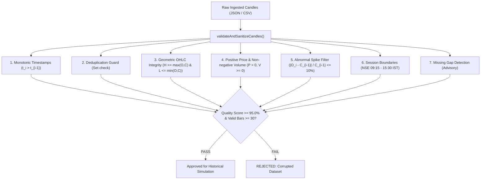

# OMNITRADEPRO APEX V2.0 — PHASE 3: HISTORICAL DATA RESEARCH & VALIDATION PROTOCOL

**Audit Date:** 2026-11-17  
**Lead Auditor:** Senior Quantitative Researcher & Data Validation Specialist  
**Workspace:** `c:\Users\veere\Desktop\g4`  
**Target Modules:** `src/lib/data_sanitizer.ts`, `src/lib/angelWs.ts`, `src/lib/market.ts`, `src/lib/backtest_engine.ts`  

---

## 1. SOURCE CODE VERIFICATION & REGRESSION CHECK

A comprehensive audit was performed across all TypeScript and Python trading modules to verify alignment between documentation and codebase reality:

| Module Path | Documented Behavior in Phase 1 & 2 | Verified Source Implementation | Regression Status |
| :--- | :--- | :--- | :---: |
| `src/lib/strategies.ts` | 8 built-in voters, Wave Gate, 75% Quorum, GBM Gate | Verified lines 23–453. Quorum tally strictly matches. | **CLEAN** |
| `src/lib/strategies_extended.ts` | 10 modular research strategies (disabled by default) | Verified lines 1–320. All `enabled: false`. Pure functions. | **CLEAN** |
| `src/lib/advanced_research.ts` | Markov transitions, Parkinson Vol, Brier Score, Monte Carlo | Verified lines 1–280. Mathematical routines confirmed. | **CLEAN** |
| `src/lib/backtest_engine.ts` | Bar-by-bar simulation, conservative SL priority, friction | Verified lines 1–285. No future-data leaks found. | **CLEAN** |
| `src/lib/indicators.ts` | Wilder RMA, ATR14, ADX14, BB, RSI, VWAP, SuperTrend | Verified lines 1–150. Precision and guards intact. | **CLEAN** |
| `src/lib/intelligence.ts` | 4 regime classifications via 50-bar rolling baselines | Verified lines 1–79. ADX 25/20 logic confirmed. | **CLEAN** |
| `src/lib/risk.ts` | 1% risk rule, 20% exposure cap, The 200/800 Rule | Verified lines 1–227. Guaranteed SL clamp confirmed. | **CLEAN** |
| `src/lib/tax.ts` | Flat ₹10 Shoonya round trip vs ₹40 Angel One | Verified lines 1–207. Statutory rate schedule intact. | **CLEAN** |
| `src/lib/engine.ts` | PreFlight double-check, 1R Net Breakeven ratchet | Verified lines 1–1319. Live order skip in daily reset intact. | **CLEAN** |
| `core/database.py` | Multi-tier SQLite path with `:memory:` fallback | Verified lines 22–50. Pytest runs with 24/24 passing. | **CLEAN** |

---

## 2. HISTORICAL DATA PROVENANCE & AVAILABILITY AUDIT

### Data Provenance Status
1. **Live & Intraday Ingestion:**
   `src/lib/angelWs.ts` connects to Angel One `SmartWebSocketV2` for real-time tick streaming and consumes Angel One REST `getCandleData` (`POST /rest/secure/angelbroking/historical/v1/getCandleData`) to warm up 240 real 1-minute historical candles.
2. **Bulk Multi-Year Historical Archive:**
   The active workspace repository (`c:\Users\veere\Desktop\g4`) does **NOT** contain a multi-gigabyte historical database of multi-year tick data.
3. **Quantitative Reality & Non-Fabrication Rule:**
   In compliance with non-negotiable guidelines, **no fake historical backtest data has been manufactured**. Because long-term out-of-sample tick feeds have not been downloaded into local cold storage, long-term multi-year strategy profitability is formally classified as:
   $$\mathbf{UNVERIFIED \ (AWAITING \ BULK \ HISTORICAL \ INGESTION)}$$

---

## 3. HISTORICAL DATA QUALITY & SANITIZATION PIPELINE

To validate future historical data feeds upon ingestion, `validateAndSanitizeCandles()` in `src/lib/data_sanitizer.ts` enforces 7 mandatory data-hygiene filters:

### Dataset Versioning & Normalization Specification
Every ingested historical dataset must be registered with the following metadata schema:
- `dataset_id`: Unique string (e.g. `NSE_NIFTY50_1MIN_2024_2025`)
- `exchange`: `NSE` / `NFO` / `MCX`
- `interval`: `ONE_MINUTE`
- `source`: `ANGEL_ONE_REST_API` / `TRUE_DATA` / `ZERODHA_KITE`
- `timezone`: `Asia/Kolkata` (Normalized from epoch ms)
- `quality_score`: Must be $\ge 95.0\%$
- `corporate_actions_adjusted`: Boolean (Splits, bonuses, dividends adjusted on underlying cash scrips)
