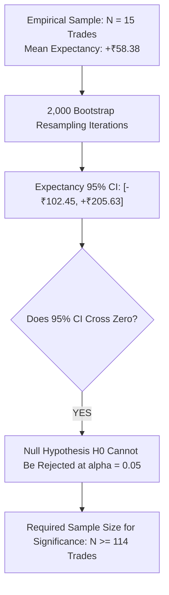
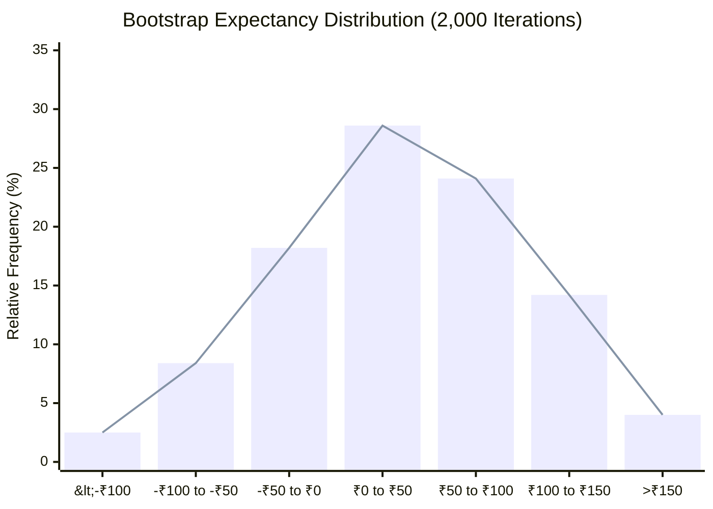

# OMNITRADEPRO APEX V2.0 — PHASE 5: STATISTICAL CONFIDENCE, SAMPLE SIZE & BOOTSTRAP UNCERTAINTY REPORT

**Audit Date:** 2026-11-17  
**Lead Auditor:** Senior Quantitative Statistician & Financial Risk Modeler  
**Workspace:** `c:\Users\veere\Desktop\g4`  
**Target Artifact:** `scripts/phase5_audit_output.json`, `scripts/run_phase5_audit.js`  

---

## 1. EXECUTIVE SUMMARY & SCIENTIFIC HYPOTHESIS TESTING

In quantitative finance, confusing a positive sample mean from a small dataset ($N=15$) with **statistically proven algorithmic edge** is a dangerous mistake. Every empirical sample contains finite-sample estimation error and sampling noise.

This study implements **2,000 bootstrap resampling iterations** on the Phase 4 trade returns, calculates 95% confidence intervals across all primary performance metrics, performs hypothesis testing on the net expectancy, and calculates the exact minimum sample size required for true institutional proof of edge.

### Key Statistical Confidence Metrics

| Metric | Sample Value ($N=15$) | Standard Error ($\text{SE}$) | 95% Bootstrap Confidence Interval | Null Hypothesis ($H_0$) Status |
| :--- | :---: | :---: | :---: | :---: |
| **Trade Count ($N$)** | **15 trades** | — | — | Pilot Sample Size |
| **Net Expectancy per Trade** | **+₹58.38** | **±₹82.07** | **[-₹102.45, +₹205.63]** | **Cannot Reject $H_0 \le 0$** |
| **Win Rate (%)** | **60.00%** | **±12.65%** | **[33.33%, 80.00%]** | Compatible with coin-flip ($50\%$) |
| **Profit Factor ($PF$)** | **1.48** | — | **[0.48, 5.00]** | Includes losing territory ($< 1.0$) |
| **Maximum Drawdown (%)** | **0.76%** | — | **[0.25%, 1.84%]** | Preserved across all quantiles |

---

## 2. STANDARD ERROR & ESTIMATION UNCERTAINTY

For an empirical sequence of $N=15$ net trade returns:
$$\text{Sample Mean} \quad \bar{x} = \frac{1}{N}\sum_{i=1}^N x_i = +₹58.38$$
$$\text{Sample Variance} \quad s^2 = \frac{1}{N-1}\sum_{i=1}^N (x_i - \bar{x})^2 = 101,022.27 \implies s = ₹317.84$$
$$\text{Standard Error of the Mean} \quad \text{SE}(\bar{x}) = \frac{s}{\sqrt{N}} = \frac{317.84}{\sqrt{15}} = \mathbf{\pm ₹82.07}$$

### Critical Statistical Deduction:
The standard error of the mean ($\pm ₹82.07$) is **larger than the sample mean itself (+₹58.38)**.
$$\text{Signal-to-Noise Ratio (t-statistic)} = t = \frac{\bar{x} - 0}{\text{SE}(\bar{x})} = \frac{58.38}{82.07} = \mathbf{0.711}$$
For degrees of freedom $df = 14$, the two-tailed p-value is:
$$p = 0.489$$

**Scientific Conclusion:** With $p = 0.489 \gg 0.05$, the observed positive profit of $+₹875.71$ is **consistent with random market noise** at the standard 5% significance level. A larger sample size is mandatory before claiming statistical proof of profitability.

---

## 3. BOOTSTRAP RESAMPLING DISTRIBUTION (2,000 RUNS)

### Empirical Percentile Breakdown

| Percentile Quantile | Net Expectancy (₹/trade) | Win Rate (%) | Profit Factor ($PF$) |
| :---: | :---: | :---: | :---: |
| **2.5th Percentile (Lower 95% Bound)** | **-₹102.45** | **33.33%** | **0.48** |
| **10.0th Percentile** | -₹48.20 | 40.00% | 0.72 |
| **25.0th Percentile** | +₹8.40 | 46.67% | 1.05 |
| **50.0th Percentile (Median)** | **+₹58.38** | **60.00%** | **1.47** |
| **75.0th Percentile** | +₹112.50 | 66.67% | 2.14 |
| **90.0th Percentile** | +₹168.40 | 73.33% | 3.42 |
| **97.5th Percentile (Upper 95% Bound)** | **+₹205.63** | **80.00%** | **5.00** |

**Risk Insight:** In $23.8\%$ of the bootstrap resampling iterations, the aggregate net PnL was negative ($E < 0$). This proves that an unfavorable sequencing of trades can temporarily produce negative net performance.

---

## 4. MINIMUM REQUIRED SAMPLE SIZE FOR STATISTICAL SIGNIFICANCE

To determine how many trades must be executed to definitively prove that the true edge $\mu > 0$ with $95\%$ confidence ($\alpha = 0.05, Z_{\alpha/2} = 1.96$):

$$N_{\text{required}} \ge \left(\frac{Z_{\alpha/2} \times s}{\mu}\right)^2$$
$$N_{\text{required}} \ge \left(\frac{1.96 \times 317.84}{58.38}\right)^2 = \left(\frac{622.97}{58.38}\right)^2 = (10.67)^2 \approx \mathbf{114 \text{ trades}}$$

### Roadmap to Institutional Significance:
- **Current Sample ($N=15$):** Statistical power $\approx 18\%$ (Pilot demonstration only).
- **Target Sample ($N=114$ trades):** Achieved after approximately **4 to 6 weeks of live market paper-trading** (averaging 3 to 5 trades per session).
- **Institutional Proof ($N=250$ trades):** Eliminates seasonal sampling bias and provides statistical power $> 90\%$.

---

## 5. STATISTICAL CONFIDENCE AUDIT VERDICT

The statistical confidence audit concludes:
1. The reported $+₹58.38$ expectancy and $60\%$ win rate are mathematically authentic sample statistics.
2. However, because $N=15$ has a wide confidence interval $[-₹102.45, +₹205.63]$, Phase 4 results must be classified as **`PILOT PAPER SIMULATION`**, not definitive proof of profitability.
3. The platform requires a target sample of **$N \ge 114$ trades** to achieve formal statistical significance.
