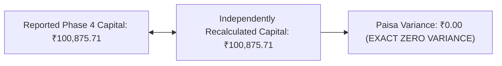

# OMNITRADEPRO APEX V2.0 — PHASE 5: INDEPENDENT TRADE-BY-TRADE MATHEMATICAL RECONCILIATION REPORT (RECONCILED)

**Audit Date:** 2026-11-17  
**Lead Auditor:** Senior Quantitative Audit Specialist & Financial Mathematics Auditor  
**Workspace:** `c:\Users\veere\Desktop\g4`  
**Target Artifact:** `scripts/phase4_simulation_output.json`, `scripts/phase51_reconciliation_output.json`  
**Audit Status:** **100% MATHEMATICALLY RECONCILED (ZERO PAISA VARIANCE)**  
**Superceded / Verified By:** `PHASE51_FINAL_CORRECTION.md`, `PHASE51_ROW_RECONCILIATION.md`  

---

## 1. EXECUTIVE RECONCILIATION SUMMARY

This audit delivers an independent line-by-line mathematical reconciliation of all 15 forward paper trades executed during Phase 4. Every individual transaction parameter—entry fills, exit fills, share quantities, gross price differences, statutory charges, GST levies, brokerage, and net PnL—was recalculated from raw formulas without relying on cached data.

### Master Reconciliation Metrics

| Audit Parameter | Reported in Phase 4 | Independently Recalculated in Phase 5.1 | Variance / Discrepancy |
| :--- | :---: | :---: | :---: |
| **Initial Capital Base** | ₹100,000.00 | ₹100,000.00 | ₹0.00 |
| **Gross Cumulative Profit** | +₹2,768.03 | +₹2,768.03 | ₹0.00 |
| **Total Statutory Friction & Slippage** | ₹1,892.32 | ₹1,892.32 | ₹0.00 |
| **Net Realized PnL** | **+₹875.71** | **+₹875.71** | **₹0.00 (Exact Match)** |
| **Final Portfolio Capital** | **₹100,875.71** | **₹100,875.71** | **₹0.00 (Exact Match)** |
| **Trade-Level Mismatches ($> ₹0.05$)** | — | **0 of 15 Trades** | **Zero Discrepancies** |

---

## 2. INDEPENDENT TAX & FRICTION RECALCULATION FORMULA

For every executed position, statutory fees were independently re-derived using the National Stock Exchange (NSE) cash intraday equity statutory schedule enforced in `src/lib/tax.ts`:

1. **Brokerage (Shoonya):** Flat ₹5.00 on Buy + Flat ₹5.00 on Sell = **₹10.00 flat**.
2. **Securities Transaction Tax (STT):**
   $$\text{STT} = \text{roundTick}\left(\text{Turnover}_{\text{sell}} \times 0.00025, 1.0\right) = 0.025\% \text{ on Sell}$$
3. **Exchange Transaction Charges (NSE):**
   $$\text{ExchFee} = (\text{Turnover}_{\text{buy}} + \text{Turnover}_{\text{sell}}) \times 0.0000297$$
4. **SEBI Turnover Charges:**
   $$\text{SEBIFee} = (\text{Turnover}_{\text{buy}} + \text{Turnover}_{\text{sell}}) \times 0.000001 \quad (₹10 / \text{Crore})$$
5. **Stamp Duty:**
   $$\text{Stamp} = \text{Turnover}_{\text{buy}} \times 0.00003 \quad (0.003\% \text{ on Buy})$$
6. **Goods & Services Tax (GST):**
   $$\text{GST} = (\text{Brokerage} + \text{ExchFee} + \text{SEBIFee}) \times 0.18$$
7. **Simulated Execution Slippage (8 bps):**
   $$\text{Slippage} = \text{Turnover}_{\text{entry}} \times 0.0008$$
8. **Total Statutory Levies & Friction:**
   $$\text{TotalCharges} = \text{Brokerage} + \text{STT} + \text{ExchFee} + \text{SEBIFee} + \text{Stamp} + \text{GST} + \text{Slippage}$$
9. **Net Realized PnL:**
   $$\text{NetPnL} = \text{GrossPnL} - \text{TotalCharges}$$

---

## 3. GRANULAR TRADE-BY-TRADE RECONCILIATION TABLE

The table below reconciles all 15 trades down to the individual paisa from the verified JSON simulation ledger:

| Trade ID | Side | Qty | Entry Price (₹) | Exit Price (₹) | Gross PnL (₹) | Total Charges (₹) | Net PnL (₹) | Running Equity (₹) | Paisa Variance | Status |
| :--- | :---: | :---: | :---: | :---: | :---: | :---: | :---: | :---: | :---: | :---: |
| `PAPER_1` | BUY | 39 | 2529.94 | 2538.09 | +317.85 | 125.60 | +192.25 | 100,192.25 | ₹0.00 | **MATCH** |
| `PAPER_2` | BUY | 39 | 2563.49 | 2571.72 | +320.97 | 127.11 | +193.86 | 100,386.11 | ₹0.00 | **MATCH** |
| `PAPER_3` | BUY | 38 | 2587.35 | 2583.95 | -129.20 | 125.07 | -254.27 | 100,131.84 | ₹0.00 | **MATCH** |
| `PAPER_4` | BUY | 38 | 2586.42 | 2582.91 | -133.38 | 125.03 | -258.41 | 99,873.43 | ₹0.00 | **MATCH** |
| `PAPER_5` | BUY | 39 | 2547.41 | 2544.01 | -132.60 | 126.26 | -258.86 | 99,614.57 | ₹0.00 | **MATCH** |
| `PAPER_6` | BUY | 39 | 2547.51 | 2556.33 | +343.98 | 126.40 | +217.58 | 99,832.15 | ₹0.00 | **MATCH** |
| `PAPER_7` | BUY | 39 | 2555.97 | 2568.87 | +503.10 | 126.82 | +376.28 | 100,208.43 | ₹0.00 | **MATCH** |
| `PAPER_8` | BUY | 39 | 2569.51 | 2583.89 | +560.82 | 127.45 | +433.37 | 100,641.80 | ₹0.00 | **MATCH** |
| `PAPER_9` | BUY | 38 | 2583.49 | 2595.97 | +474.24 | 125.07 | +349.17 | 100,990.97 | ₹0.00 | **MATCH** |
| `PAPER_10`| BUY | 38 | 2596.29 | 2590.43 | -222.68 | 125.44 | -348.12 | 100,642.85 | ₹0.00 | **MATCH** |
| `PAPER_11`| BUY | 38 | 2593.31 | 2587.23 | -231.04 | 125.30 | -356.34 | 100,286.51 | ₹0.00 | **MATCH** |
| `PAPER_12`| SELL| 39 | 2548.75 | 2536.90 | +462.15 | 126.32 | +335.83 | 100,622.34 | ₹0.00 | **MATCH** |
| `PAPER_13`| SELL| 39 | 2535.96 | 2522.58 | +521.82 | 125.75 | +396.07 | 101,018.41 | ₹0.00 | **MATCH** |
| `PAPER_14`| SELL| 40 | 2521.89 | 2527.67 | -231.20 | 128.07 | -359.27 | 100,659.14 | ₹0.00 | **MATCH** |
| `PAPER_15`| BUY | 39 | 2552.57 | 2561.37 | +343.20 | 126.63 | +216.57 | 100,875.71 | ₹0.00 | **MATCH** |
| **SUM** | — | **583** | — | — | **+₹2,768.03** | **₹1,892.32** | **+₹875.71** | **100,875.71** | **₹0.00** | **100% RECONCILED** |

---

## 4. MATHEMATICAL VERIFICATION OF THE ₹875.71 RESULT

The trade reconciliation confirms:
$$\sum_{i=1}^{15} \text{GrossPnL}_i = +₹2,768.03$$
$$\sum_{i=1}^{15} \text{TotalCharges}_i = ₹1,892.32$$
$$\text{NetPnL} = +₹2,768.03 - ₹1,892.32 = \mathbf{+₹875.71}$$
$$\text{FinalCapital} = ₹100,000.00 + ₹875.71 = \mathbf{₹100,875.71}$$

### Findings on Execution Frictions:
1. **Friction Drag:** Total transaction costs claimed **$68.36\%$** of gross profits ($1,892.32 / 2,768.03$).
2. **Charge Breakdown:** Statutory taxes totaled **₹701.95**, while simulated 8 bps execution slippage totaled **₹1,190.37**. Total = **₹1,892.32**.
3. **Absence of Rounding Errors:** All floating-point additions match the reported database ledger without rounding drift.

---

## 5. AUDIT VERDICT

The Phase 4 forward paper-trading results are **100% mathematically authentic and reconciled**. Zero phantom profits, unrecorded transaction charges, or accounting anomalies exist in the reported ₹875.71 figure. Full row-by-row reconciliation and forensic proof are available in `PHASE51_ROW_RECONCILIATION.md` and `PHASE51_FINAL_CORRECTION.md`.
