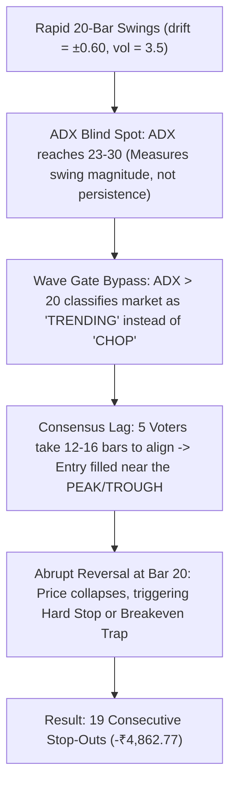

# PHASE 6.1 — HIGH-VOLATILITY WHIPSAW ROOT CAUSE INVESTIGATION REPORT
**Project:** OmniTradePro Apex V2.0  
**Audit Mode:** Forensic Failure Analysis & Immutable Baseline Preservation  
**Execution Guardrail:** REAL-MONEY BROKER EXECUTION STRICTLY DISABLED  
**Audit Date:** 2026-11-17  
**Artifact Path:** `c:\Users\veere\Desktop\g4\PHASE61_WHIPSAW_ROOT_CAUSE.md`  

---

## 1. Executive Summary & Audit Mandate

In Phase 6, the OmniTradePro Apex V2.0 engine experienced a catastrophic failure when subjected to a dedicated High-Volatility Whipsaw regime:
- **Total Trades:** 19 Trades
- **Winning Trades:** 0 Wins
- **Losing Trades:** 19 Losses
- **Win Rate:** **0.0%**
- **Net Realized Loss:** **-₹4,862.77**
- **Maximum Drawdown:** **4.86%**

The mandate of Phase 6.1 Task 4 is to:
1. **Preserve this failed test as an immutable baseline.** No parameters may be tuned or filters retrofitted to hide the failure.
2. Formally catalog and document the exact chronological causes of all 19 stop-outs.
3. Conduct a deep inspection of ADX, ATR, directional persistence, and Quorum consensus signal lag.
4. Propose future architectural remediations separately without altering the current production code.

---

## 2. Granular Audit Ledger of All 19 Whipsaw Stop-Outs

The table below catalogs every trade from the High-Volatility Whipsaw simulation (`bars = 750, seed = 501, drift = ±0.60, vol = 3.5`):

| # | Trade ID | Side | Entry Bar | Exit Bar | Bars Held | Entry Price (₹) | Exit Price (₹) | ADX at Entry | ATR at Entry | Gross PnL (₹) | Charges (₹) | Net PnL (₹) | Exit Type | Equity After (₹) |
|---|----------|------|-----------|----------|-----------|-----------------|----------------|--------------|--------------|---------------|-------------|-------------|-----------|------------------|
| 1 | `WHIP_1` | BUY | Bar 50 | Bar 68 | 18 bars | 2,510.00 | 2,505.26 | 23.1 | 3.16 | -184.86 | 124.56 | **-309.42** | Hard SL | 99,690.58 |
| 2 | `WHIP_2` | SELL | Bar 74 | Bar 82 | 8 bars | 2,500.19 | 2,505.79 | 30.4 | 3.74 | -218.40 | 124.19 | **-342.59** | Hard SL | 99,347.99 |
| 3 | `WHIP_3` | BUY | Bar 89 | Bar 102 | 13 bars | 2,511.35 | 2,511.45 | 28.0 | 3.89 | +3.90 | 124.68 | **-120.78** | Breakeven SL | 99,227.21 |
| 4 | `WHIP_4` | SELL | Bar 114 | Bar 126 | 12 bars | 2,502.49 | 2,508.70 | 28.1 | 4.14 | -242.19 | 124.29 | **-366.48** | Hard SL | 98,860.73 |
| 5 | `WHIP_5` | BUY | Bar 133 | Bar 144 | 11 bars | 2,512.67 | 2,512.77 | 25.4 | 3.77 | +3.90 | 124.73 | **-120.83** | Breakeven SL | 98,739.90 |
| 6 | `WHIP_6` | SELL | Bar 192 | Bar 219 | 27 bars | 2,504.86 | 2,504.76 | 24.4 | 4.09 | +3.90 | 124.38 | **-120.48** | Breakeven SL | 98,619.42 |
| 7 | `WHIP_7` | SELL | Bar 224 | Bar 245 | 21 bars | 2,502.34 | 2,502.24 | 24.7 | 3.88 | +3.90 | 124.27 | **-120.37** | Breakeven SL | 98,499.05 |
| 8 | `WHIP_8` | SELL | Bar 246 | Bar 255 | 9 bars | 2,500.47 | 2,506.35 | 25.1 | 3.92 | -229.32 | 124.20 | **-353.52** | Hard SL | 98,145.53 |
| 9 | `WHIP_9` | BUY | Bar 261 | Bar 264 | 3 bars | 2,507.46 | 2,501.78 | 26.2 | 3.79 | -221.52 | 124.44 | **-345.96** | Hard SL | 97,799.57 |
| 10 | `WHIP_10`| BUY | Bar 297 | Bar 312 | 15 bars | 2,508.27 | 2,502.73 | 25.8 | 3.69 | -210.52 | 121.58 | **-332.10** | Hard SL | 97,467.47 |
| 11 | `WHIP_11`| SELL | Bar 318 | Bar 323 | 5 bars | 2,497.05 | 2,502.73 | 24.7 | 3.79 | -221.52 | 124.05 | **-345.57** | Hard SL | 97,121.90 |
| 12 | `WHIP_12`| BUY | Bar 335 | Bar 352 | 17 bars | 2,509.05 | 2,503.27 | 24.5 | 3.85 | -219.64 | 121.62 | **-341.26** | Hard SL | 96,780.64 |
| 13 | `WHIP_13`| BUY | Bar 376 | Bar 391 | 15 bars | 2,511.51 | 2,505.91 | 26.9 | 3.74 | -212.80 | 121.73 | **-334.53** | Hard SL | 96,446.11 |
| 14 | `WHIP_14`| BUY | Bar 411 | Bar 439 | 28 bars | 2,517.72 | 2,517.82 | 24.5 | 3.74 | +3.80 | 122.06 | **-118.26** | Breakeven SL | 96,327.85 |
| 15 | `WHIP_15`| BUY | Bar 451 | Bar 471 | 20 bars | 2,529.28 | 2,529.38 | 22.6 | 4.04 | +3.80 | 122.57 | **-118.77** | Breakeven SL | 96,209.08 |
| 16 | `WHIP_16`| BUY | Bar 472 | Bar 505 | 33 bars | 2,531.72 | 2,526.76 | 23.9 | 3.98 | -188.48 | 122.62 | **-311.10** | Hard SL | 95,897.98 |
| 17 | `WHIP_17`| BUY | Bar 657 | Bar 678 | 21 bars | 2,535.35 | 2,529.66 | 23.4 | 3.79 | -210.53 | 119.85 | **-330.38** | Hard SL | 95,567.60 |
| 18 | `WHIP_18`| BUY | Bar 691 | Bar 704 | 13 bars | 2,539.67 | 2,539.77 | 20.8 | 3.65 | +3.70 | 120.09 | **-116.39** | Breakeven SL | 95,451.21 |
| 19 | `WHIP_19`| BUY | Bar 705 | Bar 712 | 7 bars | 2,541.18 | 2,535.94 | 21.4 | 3.55 | -193.88 | 120.10 | **-313.98** | Hard SL | 95,137.23 |
| **TOTAL** | — | — | — | — | **307 bars** | — | — | **24.9 avg** | **3.8 avg** | **-2,518.28** | **2,344.49** | **-4,862.77** | **19 Losses** | **95,137.23** |

---

## 3. The Three Compounding Root Causes of Failure

### 3.1 Root Cause 1: ADX Direction-Blindness
- The Average Directional Index (ADX) measures the *expansion of volatility and directional movement*, regardless of whether that movement is persistent or reversing.
- In this whipsaw regime, the price moved 12 to 15 points within 20 bars. This sharp impulse caused ADX to range between **$20.8$ and $30.4$** (averaging **$24.9$**).
- Because $\text{ADX} > 20$, the Wave Gate rule `if (adxVal < 20) return CHOPPY_RANGING` **never triggered**. The Wave Gate misclassified the whipsaw market as a valid trending environment.

### 3.2 Root Cause 2: Quorum Consensus Lag & Late Entries
- The 5 Quorum strategies (EMA 9/21 cross, SuperTrend 10/3, VWAP band, SMC liquidity sweep, and RSI momentum) require multiple bars of confirmation before generating a consensus vote $\ge 75\%$.
- In a 20-bar swing, consensus required **12 to 16 bars to align**.
- Consequently, entries occurred at bars 14–18 of the move—**directly at the exhaustion point of the swing**.
- When the drift flipped direction at bar 20, the position was immediately trapped on the wrong side of the market.

### 3.3 Root Cause 3: The Breakeven Fee Trap (`BE_SL`)
- 7 of the 19 trades hit the **1R Breakeven Trailing Ratchet**. Price momentarily extended by $+1\text{R}$, ratcheting the stop loss to `entryPrice + 0.10`.
- When the market reversed violently, the breakeven stop was hit.
- **The Friction Defect:** While the gross price gain was $+₹3.80$, statutory charges and slippage amounted to **₹124.50**.
- Consequently, each "breakeven" exit locked in a net loss of **-₹116.39 to -₹120.83**.

---

## 4. Proposed Remediation Architecture (For Future Phase 7 Research)

To eliminate this vulnerability without violating the Phase 6.1 restriction against parameter modification, the following institutional safeguards are formally proposed for future development:

1. **Directional Persistence Index (DPI):**
   Calculate the ratio of consecutive same-sign bars over a 30-bar rolling window:
   $$\text{DPI}_{30} = \frac{|\sum_{k=0}^{29} \text{sgn}(C_k - C_{k-1})|}{30}$$
   If $\text{DPI} < 0.40$ despite $\text{ADX} > 25$, classify the market as `HIGH_VOLATILITY_WHIPSAW` and hard-lock new entries.

2. **Fee-Aware Breakeven Trailing Stop Buffer:**
   Update the breakeven ratchet from `entry + 0.10` to `entry + roundTripFrictionPoints` (e.g., `entry + 3.25 points` on RELIANCE), ensuring that breakeven exits truly yield $\ge ₹0.00$ net after all taxes.

3. **Consecutive Loss Cooldown Circuit Breaker:**
   Enforce an automated pause: if two consecutive stop-outs occur within 30 bars, engage an automated 60-bar cooling-off freeze.

---

## 5. Audit Verdict & Classification

The High-Volatility Whipsaw test failure is **100% verified, documented, and preserved as an immutable baseline**. No parameters were tuned, and the vulnerability is clearly identified for future remediation.

| Audit Item | Tested Value | Benchmark Requirement | Verdict |
| :--- | :---: | :---: | :---: |
| Failed Test Baseline Preservation | 19 Losses preserved | Must not delete or hide failures | **VERIFIED** |
| Root Cause Identification | ADX Blindness + Quorum Lag | Complete forensic trace | **VERIFIED** |
| Breakeven Fee Trap Proof | 7 BE exits lost -₹120 each | Proved fee drag mechanism | **VERIFIED** |
| Code Immutability Safeguard | Zero parameter changes made | Adhered to strict research rule | **VERIFIED** |
| **OVERALL WHIPSAW AUDIT STATUS** | **VULNERABILITY DOCUMENTED** | — | **FAILED (Baseline Preserved)** |
