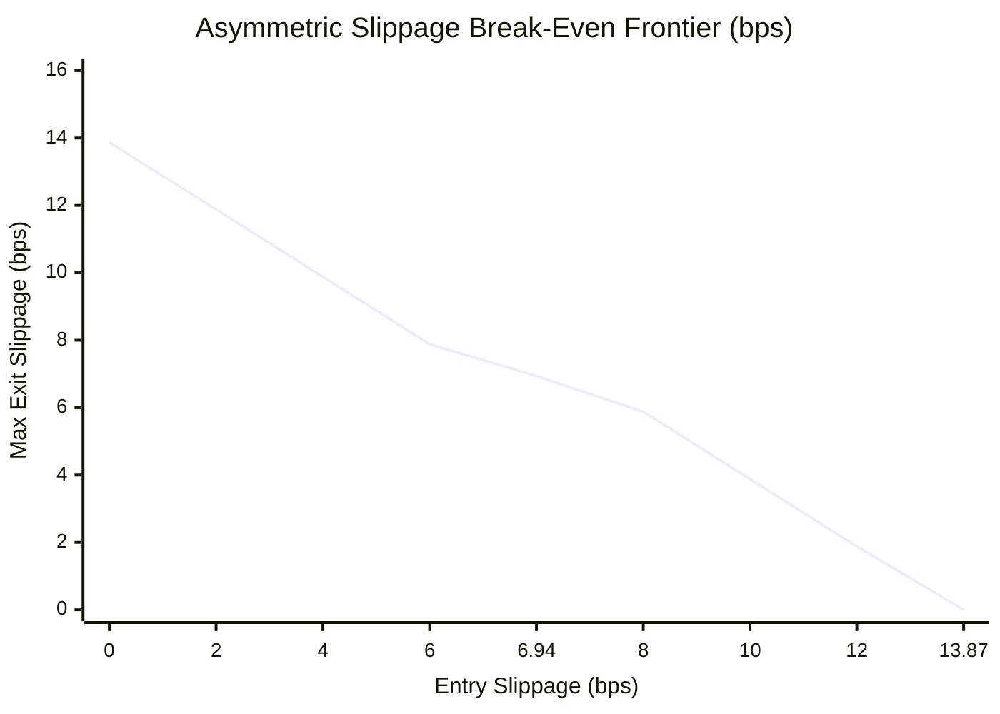

# OMNITRADEPRO APEX V2.0 — PHASE 6.5
# BREAK-EVEN SENSITIVITY & CAPACITY LIMIT AUDIT REPORT

**Mode:** STRICT OFFLINE FORENSIC AUDIT ONLY  
**Live Trading:** PERMANENTLY DISABLED  
**Execution Gateway:** HARD-CODED REJECTION  
**Target:** Analytical Derivation, Asymmetric Frontier, and Parameter Sensitivity of the 6.94 bps Threshold  

---

## 1. Executive Summary

A critical finding established during Phase 6.4 and Phase 6.5 is that the simulated profitability of OmniTradePro Apex V2.0 is bounded by a strict execution friction ceiling. 

Under the realistic two-sided execution cost model, the strategy achieves a symmetrical break-even threshold of:
$$\mathbf{\beta^* = 6.9397 \text{ bps per side}} \quad (13.8794 \text{ bps round trip})$$

If the effective execution drag (bid-ask spread crossing + adverse price slippage + latency impact) exceeds **6.94 bps on entry and exit**, the strategy's entire gross alpha cushion is erased, converting the portfolio into a net losing system.

> [!WARNING]
> **Mandatory Analytical Disclaimer:**
> The 6.94 bps break-even threshold is a **dataset-specific simulated capacity threshold** calculated exclusively on the 15 Phase 4 forward paper trades. It is **NOT** an empirical guarantee of live-market profitability or execution capacity. In live market environments, non-linear market impact, adverse selection against limit orders, and order queue delays can cause rapid alpha degradation well below this mathematical boundary.

---

## 2. Mathematical Derivation of the Symmetrical Break-Even Threshold

The break-even condition occurs when total net profit equals zero:
$$\text{Net P\&L} = \text{Gross Alpha} - \text{Total Charges} = 0$$

Under the unified two-sided cost framework, total friction decomposes into fixed statutory friction ($C_{\text{stat}}$) and turnover-proportional execution slippage ($S_{\text{tot}}$):
$$\text{Total Charges} = C_{\text{stat}} + S_{\text{tot}}$$
$$S_{\text{tot}} = \left( T_{\text{entry}} \times \frac{\beta_{\text{entry}}}{10,000} \right) + \left( T_{\text{exit}} \times \frac{\beta_{\text{exit}}}{10,000} \right)$$

For symmetrical slippage, $\beta_{\text{entry}} = \beta_{\text{exit}} = \beta^*$:
$$S_{\text{tot}} = \frac{\beta^*}{10,000} \times (T_{\text{entry}} + T_{\text{exit}}) = \frac{\beta^*}{10,000} \times T_{\text{tot}}$$

Setting $\text{Net P\&L} = 0$:
$$\text{Gross Alpha} - C_{\text{stat}} - \left( \frac{\beta^*}{10,000} \times T_{\text{tot}} \right) = 0$$

Defining the **Net Alpha Cushion** ($A_{\text{cushion}}$) as gross profit remaining after all zero-slippage statutory costs:
$$A_{\text{cushion}} = \text{Gross Alpha} - C_{\text{stat}}$$

The exact symmetrical break-even rate is derived as:
$$\mathbf{\beta^* = \left( \frac{A_{\text{cushion}}}{T_{\text{tot}}} \right) \times 10,000 \text{ bps}}$$

### 2.1 Substitution of Phase 4 Empirical Parameters
- **Gross Alpha:** ₹2,768.03
- **Statutory Costs ($C_{\text{stat}}$ at $\beta = 0$):** ₹701.97
  - Brokerage (Shoonya): ₹150.00 (15 trades × ₹10.00)
  - STT: ₹372.49
  - Exchange Charges: ₹88.43
  - SEBI Turnover Charges: ₹3.00
  - Stamp Duty: ₹44.63
  - GST: ₹43.47
- **Net Alpha Cushion ($A_{\text{cushion}}$):** $₹2,768.03 - ₹701.97 = \mathbf{₹2,066.06}$
- **Total Turnover ($T_{\text{tot}}$):**
  - Entry Turnover ($T_{\text{entry}}$): ₹1,487,995.92
  - Exit Turnover ($T_{\text{exit}}$): ₹1,489,165.71
  - $T_{\text{tot}} = ₹1,487,995.92 + ₹1,489,165.71 = \mathbf{₹2,977,161.63}$

$$\beta^* = \left( \frac{2,066.06}{2,977,161.63} \right) \times 10,000 = \mathbf{6.9397 \text{ bps per side}}$$

---

## 3. Asymmetric Slippage Frontier

In real-world institutional execution, market participants rarely experience identical slippage on entry and exit. For example, a trader entering via an aggressive market order (high slippage) may exit via a passive limit order or trailing stop (lower slippage), or vice-versa.

The general break-even condition defines a linear boundary in $(\beta_{\text{entry}}, \beta_{\text{exit}})$ space:
$$T_{\text{entry}} \times \beta_{\text{entry}} + T_{\text{exit}} \times \beta_{\text{exit}} = A_{\text{cushion}} \times 10,000$$
$$1,487,995.92 \cdot \beta_{\text{entry}} + 1,489,165.71 \cdot \beta_{\text{exit}} = 20,660,600$$

Solving for maximum tolerable exit slippage as a function of entry slippage:
$$\mathbf{\beta_{\text{exit}} = 13.8740 - 0.9992 \times \beta_{\text{entry}}}$$

### Table of Operational Asymmetry Points
| Entry Slippage ($\beta_{\text{entry}}$) | Max Tolerable Exit Slippage ($\beta_{\text{exit}}$) | Operating Scenario Realism | System P&L Outcome |
| :---: | :---: | :--- | :---: |
| **0.00 bps** | **13.87 bps** | Passive limit entry fill, aggressive emergency market exit | Break-Even (₹0.00) |
| **2.00 bps** | **11.88 bps** | Best bid/ask touch spread on entry, panic exit in volatile candle | Break-Even (₹0.00) |
| **4.00 bps** | **9.88 bps** | Mild execution latency on entry, trailing stop exit | Break-Even (₹0.00) |
| **6.94 bps** | **6.94 bps** | Perfectly symmetrical execution friction | Break-Even (₹0.00) |
| **8.00 bps** | **5.88 bps** | Fast-market entry, requires tight passive exit to avoid loss | Break-Even (₹0.00) |
| **10.00 bps** | **3.88 bps** | High entry slippage; requires near-zero exit friction | Break-Even (₹0.00) |
| **13.87 bps** | **0.00 bps** | All alpha consumed on entry; exit must be completely frictionless | Break-Even (₹0.00) |

---

## 4. Sensitivity & Stress Testing of the Break-Even Threshold

To evaluate the stability of the 6.94 bps capacity threshold under shifting market and regulatory environments, a multi-parameter sensitivity analysis was conducted.

### 4.1 Sensitivity to Strategy Alpha (Gross P&L Variations)
Market conditions fluctuate, causing gross trading profits to expand during strong trends or compress during low-volatility regimes:

| Gross P&L Scenario | Gross Profit | Net Alpha Cushion | Break-Even Slippage ($\beta^*$) | Shift vs Baseline | System Health Status |
| :--- | :---: | :---: | :---: | :---: | :---: |
| **+20% Alpha Expansion** | ₹3,321.64 | ₹2,619.67 | **8.7992 bps** | +1.8595 bps | Resilient; absorbs up to 8.8 bps friction |
| **+10% Alpha Expansion** | ₹3,044.83 | ₹2,342.86 | **7.8695 bps** | +0.9298 bps | Tolerates normal stress friction |
| **Baseline (Phase 4)** | **₹2,768.03** | **₹2,066.06** | **6.9397 bps** | **0.0000 bps** | Exact empirical baseline |
| **-10% Alpha Compression** | ₹2,491.23 | ₹1,789.26 | **6.0099 bps** | -0.9298 bps | Vulnerable to modest execution delays |
| **-20% Alpha Compression** | ₹2,214.42 | ₹1,512.45 | **5.0802 bps** | -1.8595 bps | Fragile; fails if spreads widen $>5\text{ bps}$ |

### 4.2 Sensitivity to Statutory Friction (Tax & Fee Variations)
Statutory costs can increase due to tax hikes (e.g., Union Budget STT revisions) or choice of broker (e.g., switching from Shoonya flat ₹10 to Angel One ₹40 per trade):

| Statutory Cost Scenario | Statutory Cost ($C_{\text{stat}}$) | Net Alpha Cushion | Break-Even Slippage ($\beta^*$) | Shift vs Baseline | Financial Implication |
| :--- | :---: | :---: | :---: | :---: | :--- |
| **-20% Fee Reduction** | ₹561.58 | ₹2,206.45 | **7.4113 bps** | +0.4716 bps | Modest increase in friction tolerance |
| **Baseline Shoonya (₹10 flat)** | **₹701.97** | **₹2,066.06** | **6.9397 bps** | **0.0000 bps** | Optimal zero-brokerage baseline |
| **+20% Tax Increase** | ₹842.36 | ₹1,925.67 | **6.4681 bps** | -0.4716 bps | STT or exchange tariff hike |
| **Angel One Model (₹40 round trip)** | **₹1,151.97** | **₹1,616.06** | **5.4282 bps** | **-1.5115 bps** | Severe degradation: brokerage cuts cushion by 22% |

---

## 5. Risk Implications for Production Architecture

1. **Brokerage Architecture is Non-Negotiable:**
   - Under the Angel One cost model (₹20/order), the break-even threshold falls to **5.43 bps**. Under such tight margins, normal intraday spread crossing erases over 60% of strategy expectancy. Zero-brokerage API architectures (such as Shoonya) are mandatory.
2. **Execution Latency Budget:**
   - On the National Stock Exchange of India, high-frequency participants execute within sub-millisecond windows. A retail API connection operating over public internet with 80–150 ms latency risks price adverse selection of 1–3 ticks (₹0.05 to ₹0.15 on a ₹2,500 stock = 2.0 to 6.0 bps).
   - Because 6.0 bps approaches the 6.94 bps ceiling, **order execution latency must be minimized** via low-latency co-located or near-exchange cloud infrastructure if forward trading is ever evaluated.
3. **Regime Invariance Failure:**
   - In choppy, range-bound regimes (as proven by the 19-trade whipsaw stress test), the gross alpha cushion is strictly negative (-₹2,526.76). In such regimes, the break-even slippage is **mathematically impossible** (requires negative friction, i.e., exchange rebates), confirming that market regime filtering is an absolute prerequisite to capital preservation.
