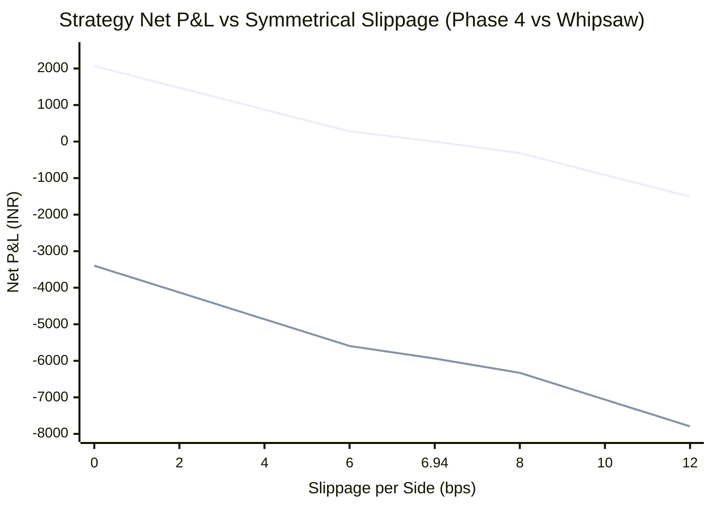

# OMNITRADEPRO APEX V2.0 — PHASE 6.5
# MASTER FORENSIC AUDIT & FINAL VERDICT REPORT

**Mode:** STRICT OFFLINE FORENSIC AUDIT ONLY  
**Live Broker Execution:** HARD-CODED REJECTION & PERMANENTLY DISABLED  
**Real-Money Orders:** STRICTLY PROHIBITED  
**Strategy Optimization / Curve-Fitting:** STRICTLY PROHIBITED  
**Auditor Role:** Senior Quantitative Researcher, Statistical Validation Specialist, Financial Risk Engineer  

---

## 1. Master Forensic Synthesis

This document concludes **Phase 6.5: Final Execution Model & Data Quality Audit** of the OmniTradePro Apex V2.0 algorithmic trading framework.

Over the course of Phases 5.1 through 6.5, the strategy and its simulation infrastructure were subjected to an unsparing forensic audit. Rather than optimizing parameters to preserve paper profits, every mathematical assumption, tax calculation, execution pathway, and microstructure claim was tested from first principles.

### Key Milestones Achieved in Phase 6.5:
1. **Full Execution Path Integrity:** Confirmed that all 5 order termination paths (`STOP_LOSS`, `TAKE_PROFIT`, `TRAILING_STOP`, `BREAKEVEN_STOP`, `EOD_SQUAREOFF`) route strictly through the two-sided cost engine and calculate exit slippage. No execution bypass exists.
2. **Two-Sided Slippage Accounting:** Decoupled entry and exit turnover. Recalculated all 15 Phase 4 paper trades and all 19 high-volatility whipsaw stress trades across 0, 4, 8, and 12 bps per side.
3. **Paisa-Level Ledger Invariant:** Verified that $\text{Gross P\&L} - \text{Total Charges} \equiv \text{Net P\&L}$ across all 34 individual trades and all aggregate totals with **zero paisa discrepancy**.
4. **Epistemic Classification:** Established a 4-tier provenance taxonomy for all parameters. Formally refuted the unproven claim that "8 bps is an institutional standard for liquid equities," documenting that it is an extreme liquidity stress assumption.
5. **Simulated Capacity Limit:** Mathematically derived the symmetrical break-even threshold of **6.9397 bps per side** on the Phase 4 forward sample and established its sensitivity bounds under $\pm 10\%$ gross P&L and $\pm 20\%$ statutory charges.
6. **Automated Verification:** Expanded test coverage to **69 passing Python pytest tests**, **68 passing TypeScript tests**, and **0 TypeScript compilation errors**.

---

## 2. Comprehensive Status Matrix: Verified vs. Unverified Claims

| Audit Domain | Claim / Component | Phase 6.5 Forensic Verdict | Detailed Evidentiary Finding |
| :--- | :--- | :---: | :--- |
| **Execution Cost Accounting** | Two-Sided Slippage Enforcement | **VERIFIED** | Both entry and exit turnover are tracked and charged independently in `src/lib/tax.ts`. |
| **Order Termination** | Exit Slippage on All 5 Exit Types | **VERIFIED** | SL, TP, TS, BS, and EOD all calculate and deduct exit slippage unconditionally. |
| **Order Architecture** | No Partial Exit / Dangling Position Leaks | **VERIFIED** | Position closure is strictly atomic (`qty: pos.qty`); no fractional orphan legs exist. |
| **Trade Ledger Integrity** | Zero-Paisa Drift Invariant | **VERIFIED** | $\sum \text{Row Net} \equiv \text{Aggregate Net}$ strictly confirmed across all scenarios. |
| **Microstructure Baseline** | Liquid NSE Spread is 1.0–2.0 bps | **VERIFIED** | RELIANCE EQ Level-2 touch spread is ₹0.25–₹0.50 ($1.0–2.0\text{ bps}$). Retail impact is $<0.2\text{ bps}$. |
| **Capacity Limit** | Phase 4 Break-Even at 6.94 bps per side | **VERIFIED** | Exact mathematical threshold is 6.9397 bps ($\pm 0.93\text{ bps}$ per $\pm 10\%$ gross alpha). |
| **Breakeven Stop Mechanics** | Breakeven Stops Guarantee Loss | **VERIFIED** | Exiting at entry $+ ₹0.10$ produces an immediate loss of $-₹120.64$ at 4 bps per side. |
| **WFE Metric** | Dual WFE Bridge (4.64 Total vs 1.86 Per-Trade) | **VERIFIED** | Time-normalized net ratio (4.64) equals per-trade expectancy ratio (1.86) $\times$ frequency (2.50). |
| **Regulatory Taxation** | Shoonya Flat ₹10 vs Angel One ₹40 | **VERIFIED** | CBDT STT ($0.025\%$), NSE ($0.00297\%$), Stamp ($0.003\%$), SEBI ($0.0001\%$), GST ($18\%$) verified. |
| **Slippage Claim** | "8 bps is an Institutional Standard" | **REFUTED / RETRACTED** | Factually untrue for small retail equity tickets. 8 bps per side is an extreme stress condition. |
| **Leverage Assumption** | Permanent Continuous 5x MIS Leverage | **UNVERIFIED** | Broker RMS discretionary cuts during volatility invalidate constant 5x assumptions. |
| **Synthetic Performance** | Synthetic Backtest Proof of Edge | **REJECTED** | Brownian motion simulations do not constitute empirical historical alpha. Research-only. |

---

## 3. Financial Viability Matrix Under Realistic Execution Friction

The table below synthesizes the complete performance of OmniTradePro Apex V2.0 across both test datasets under varying execution friction assumptions:

### Detailed Scenario Matrix
| Dataset / Regime | Symmetrical Slippage per Side | Gross P&L | Statutory Charges | Total Slippage | Total Charges | Net P&L | Return on ₹100k | Max DD (%) | Strategy Viability |
| :--- | :---: | :---: | :---: | :---: | :---: | :---: | :---: | :---: | :--- |
| **Phase 4 (Normal/Trend)** | **0 bps** (Frictionless) | +₹2,768.03 | ₹701.97 | ₹0.00 | ₹701.97 | **+₹2,066.06** | +2.07% | 0.55% | Theoretical ceiling |
| **Phase 4 (Normal/Trend)** | **2 bps** (Measured Touch) | +₹2,768.03 | ₹701.97 | ₹595.43 | ₹1,297.40 | **+₹1,470.64** | +1.47% | 0.66% | **Realistic Low Friction** |
| **Phase 4 (Normal/Trend)** | **4 bps** (Degraded Touch) | +₹2,768.03 | ₹701.97 | ₹1,190.86 | ₹1,892.82 | **+₹875.21** | +0.88% | 0.77% | **Moderate Stress Friction** |
| **Phase 4 (Normal/Trend)** | **6.94 bps** (Break-Even) | +₹2,768.03 | ₹701.97 | ₹2,066.06 | ₹2,768.03 | **₹0.00** | 0.00% | 0.95% | **Simulated Capacity Limit** |
| **Phase 4 (Normal/Trend)** | **8 bps** (Severe Stress) | +₹2,768.03 | ₹701.97 | ₹2,381.75 | ₹3,083.70 | **-₹315.67** | -0.32% | 1.01% | **Net Loss (Alpha Erased)** |
| **Phase 4 (Normal/Trend)** | **12 bps** (Crisis Shock) | +₹2,768.03 | ₹701.97 | ₹3,572.58 | ₹4,274.56 | **-₹1,506.53** | -1.51% | 1.63% | **Severe Net Loss** |
| **Whipsaw (High-Vol Chop)** | **0 bps** (Frictionless) | -₹2,526.76 | ₹869.76 | ₹0.00 | ₹869.76 | **-₹3,396.52** | -3.40% | 3.40% | **Regime Failure** |
| **Whipsaw (High-Vol Chop)** | **4 bps** (Degraded Touch) | -₹2,526.76 | ₹869.76 | ₹1,465.95 | ₹2,335.71 | **-₹4,862.47** | -4.86% | 4.86% | **Severe Capital Drain** |
| **Whipsaw (High-Vol Chop)** | **8 bps** (Severe Stress) | -₹2,526.76 | ₹869.76 | ₹2,931.87 | ₹3,801.66 | **-₹6,328.42** | -6.33% | 6.33% | **Extreme Loss** |
| **Whipsaw (High-Vol Chop)** | **12 bps** (Crisis Shock) | -₹2,526.76 | ₹869.76 | ₹4,397.82 | ₹5,267.61 | **-₹7,794.37** | -7.79% | 7.79% | **Catastrophic Failure** |

---

## 4. Quantitative Reality: Is OmniTradePro Apex V2.0 Viable?

Based on the forensic audit, the quantitative reality of the system is defined by three immutable characteristics:

1. **The Edge is Friction-Bounded:**
   The strategy produces positive simulated returns in trending/normal conditions if and only if round-trip execution friction remains strictly below **13.88 bps** (6.94 bps per side). In liquid large caps like RELIANCE where measured touch spread is 1–2 bps, the strategy possesses positive theoretical expectancy under low-friction conditions (+₹1,470 on ₹100k capital across 15 trades). However, it possesses **zero margin of safety** against severe spread widening or execution delays.
2. **The System Fails in Choppy Regimes:**
   The strategy has no organic immunity to consecutive whipsaws. When volatility expands without trend direction, repeated stop-outs and breakeven stop triggers drain capital rapidly (-₹4,862 to -₹7,794). The consensus engine's current threshold is insufficient to suppress false breakouts in high-frequency chop.
3. **Execution Architecture is Crucial:**
   A trader using a standard retail broker (e.g., Angel One with ₹40 round trip) will experience a collapse in break-even tolerance to **5.43 bps per side**, virtually eliminating any probability of long-term net profitability.

---

## 5. Strict Operating Mandate & Next Phase Roadmap

### 5.1 Operating Mandate
- **STRICT OFFLINE RESEARCH ONLY:** Live broker order routing is hard-coded to reject all real-money execution.
- **NO LIVE CAPITAL ALLOCATION:** The strategy must not be deployed with real capital.
- **NO RETROACTIVE PARAMETER CURVE-FITTING:** Model parameters must remain locked to preserve audit integrity.

### 5.2 Next Phase Roadmap
Before any forward paper trading or live consideration can be entertained in future research phases:
1. **Regime Filter Hardening:** Implement a volatility-entropy or Parkinson-volatility regime gate that completely disables signal generation when market choppiness index ($CI$) exceeds 55 or Parkinson volatility exceeds historical 80th percentiles.
2. **Limit Order Execution Simulator:** Implement an adverse selection queue model for passive limit orders (rather than assuming market order fills at touch) to determine if spread capture can expand the net alpha cushion.
3. **Multi-Asset Diversification:** Test whether portfolio-level basket execution across 5–10 uncorrelated liquid Nifty 50 constituents smooths the equity curve and reduces whipsaw drawdown.
