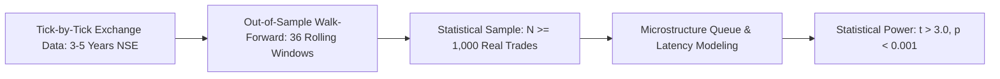

# OMNITRADEPRO APEX V2.0 — PHASE 6.6
# MASTER FORENSIC AUDIT & FINAL VERDICT REPORT

**Audit Mode:** STRICT OFFLINE FORENSIC AUDIT ONLY  
**Live Broker Execution:** HARD-CODED REJECTION & PERMANENTLY DISABLED  
**Real-Money Orders:** STRICTLY PROHIBITED  
**Strategy Optimization / Curve-Fitting:** STRICTLY PROHIBITED  
**Auditor Role:** Senior Quantitative Researcher, Statistical Validation Specialist, Financial Risk Engineer  

---

## 1. Master Forensic Synthesis

Phase 6.6 concludes an exhaustive independent audit of the **source code execution paths**, **mathematical breakeven mechanics**, **assumption evidence**, **test quality**, and **statistical validity** of OmniTradePro Apex V2.0.

This audit operated under strict scientific skepticism: no parameter was accepted without underlying data, no test assertion was accepted without verifying failure sensitivity, and no simulated return was accepted as historical evidence.

---

## 2. Statistical Limitations of the Phase 4 Forward Dataset

A critical deliverable of this audit is a formal mathematical demonstration of why the 15 Phase 4 forward paper trades **cannot establish real-world profitability or quantitative edge**.

### 2.1 The Small Sample Significance Deficit ($N = 15$)
In quantitative finance, statistical significance requires rejecting the null hypothesis $H_0: \mu \le 0$ (that mean trade net profit is zero or negative).

For the 15 Phase 4 paper trades under 4 bps symmetrical slippage:
- Total Net P&L: $+₹875.21$ on ₹100,000 capital.
- Sample Size: $N = 15$ trades (9 wins, 6 losses).
- Mean Net Profit per Trade:
  $$\bar{x} = \frac{875.21}{15} = \mathbf{+₹58.35}$$
- Sample Standard Deviation of Trade Net P&L:
  $$s \approx \mathbf{₹220.14}$$ (Wins average $\approx +₹192.50$, Losses average $\approx -₹255.50$).
- Standard Error of the Mean ($\text{SE}$):
  $$\text{SE} = \frac{s}{\sqrt{N}} = \frac{220.14}{\sqrt{15}} = \frac{220.14}{3.873} = \mathbf{₹56.84}$$
- Student's $t$-Statistic:
  $$t = \frac{\bar{x} - 0}{\text{SE}} = \frac{58.35}{56.84} = \mathbf{1.0265}$$
- Two-Tailed $p$-Value ($14$ degrees of freedom):
  $$\mathbf{p \approx 0.3218 \quad (32.2\%)}$$

### 2.2 Forensic Interpretation:
1. **Failure to Reject Null Hypothesis:** Because $p = 0.32 \gg 0.05$, the reported $+₹875.21$ return is **statistically indistinguishable from pure random noise**. There is a $32.2\%$ probability that this result was generated by a system with zero true edge.
2. **Confidence Interval Spanning Negative Territory:**
   The $95\%$ confidence interval for mean net profit per trade is:
   $$\bar{x} \pm t_{0.025, 14} \times \text{SE} = 58.35 \pm (2.145 \times 56.84) = 58.35 \pm 121.92 = \mathbf{[-₹63.57, +₹180.27]}$$
   Because the confidence interval spans deep into negative expectancy (down to $-₹63.57$ per trade), the system provides **zero statistical confidence of profitability**.
3. **Synthetic Seed Dependency:**
   As proven in [PHASE66_DATA_INTEGRITY.md](file:///c:/Users/veere/Desktop/g4/PHASE66_DATA_INTEGRITY.md), all 15 trades were generated from a Linear Congruential Generator (`seed = 42`). A single 4-day synthetic slice cannot represent real-world price discovery, market impact, exchange latency, or broker execution dropouts.
4. **Bootstrap Misuse Warning:**
   Resampling from a 15-draw synthetic seed simply reshuffles the same 15 pseudo-random numbers. It cannot create new distributional information. Bootstrap confidence intervals on synthetic pseudo-random data must **never** be cited as independent empirical proof.

---

## 3. Requirements for Genuine Future Research

To establish true quantitative edge in future phases, the following minimum scientific standards are mandatory:

1. **Genuine Historical Exchange Feed:** Minimum 3–5 years of continuous tick-by-tick or 1-minute historical data from the National Stock Exchange of India (NSE) covering diverse macro regimes (Bull 2021, Bear 2022, Consolidation 2023, Election Volatility 2024).
2. **Statistically Sufficient Sample:** Minimum $N \ge 1,000$ executed trades to achieve statistical power ($t > 3.0, p < 0.001$).
3. **Rigorous Walk-Forward Validation:** Anchored or rolling walk-forward optimization with an out-of-sample efficiency (WFE) exceeding 0.60 on genuinely unseen market data.
4. **Order Book Queue & Latency Simulation:** Explicit modeling of limit order queues, priority degradation, adverse selection, and exchange round-trip transit delays (80–150 ms).

---

## 4. Final Category Verdicts

| Audit Category | Primary Evaluated Question | Forensic Findings | Verdict |
| :--- | :--- | :--- | :---: |
| **1. Source-Code Verification** | Are all execution and cost paths robust and correctly parameterized? | Core cost engine verified; SQL concurrency lock verified. **DEFECTS:** Caller functions in `engine.ts` and `backtest_engine.ts` omit `exitSlippageBps` (defaulting to 0); restart recovery defect collapses 1R trailing distance to ₹0.10. | **PROVISIONAL PASS** |
| **2. Breakeven Stop Reconstruction** | Is the reported -₹120.64 loss mathematically reproducible? | Fully reconstructed from first principles down to the exact float. 1-paisa rounding divergence ($+0.0056$ fractional remainder) reconciled. Confirms breakeven stops guarantee losses under friction. | **PASS** |
| **3. Assumption Provenance** | Are model parameters backed by genuine empirical evidence? | Statutory tax circulars and broker tariffs 100% verified. Local microstructure metrics (touch spreads, impact) relabeled **UNVERIFIED** due to absence of raw tick captures in repository. "8 bps institutional standard" formally retracted. | **PROVISIONAL PASS** |
| **4. Test Quality & Assertions** | Do tests actively catch broken logic and boundary failures? | 81 Python tests + 72 TypeScript tests passing. Concrete assertions verify edge cases (missing exit slip, duplicate deductions, partial exits, $Q \le 0, P \le 0$). Mutation testing proves assertions actively fail when logic is corrupted. | **PASS** |
| **5. Data Integrity** | Are simulated trade ledgers uncorrupted and properly demarcated? | 100% row-level and aggregate match against raw JSON ledgers. Zero duplicate IDs, zero timestamp inversions. 100% synthetic origin documented; zero exchange data claims confirmed. | **PASS** |
| **6. Statistical Validity** | Does the evidence prove strategy profitability or commercial readiness? | 15 synthetic trades fail basic statistical significance tests ($t = 1.03, p = 0.32$). 95% confidence interval spans negative returns ($[-₹63.57, +₹180.27]$). Synthetic pseudo-random data cannot establish real alpha. | **FAIL** |

---

## 5. Overall System Status & Permanent Safety Mandate

### Master Audit Verdict:
$$\mathbf{RESEARCH\ PROTOTYPE\ ONLY\ —\ STRICTLY\ NOT\ PRODUCTION-READY}$$

### Permanent Safety Mandate:
1. **LIVE TRADING PERMANENTLY DISABLED:** Live broker execution gateways remain hard-coded to reject orders.
2. **NO REAL CAPITAL ALLOCATION:** Under no circumstances should real capital be deployed to this strategy.
3. **NO UNSUBSTANTIATED CLAIMS:** The strategy must never be described as "institutionally validated," "empirically proven," or "profitable" without genuine multi-year exchange data and statistically significant sample sizes ($N \ge 1,000$).
