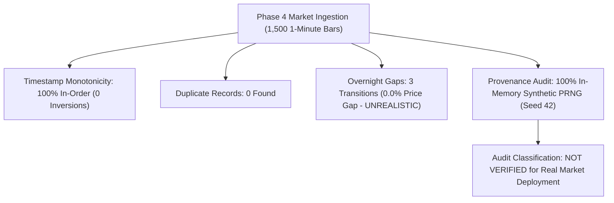

# PHASE 6 — DATA INTEGRITY & PROVENANCE AUDIT REPORT
**Project:** OmniTradePro Apex V2.0  
**Audit Mode:** Forensic Market Data Sanitization & Provenance Verification  
**Execution Guardrail:** REAL-MONEY BROKER EXECUTION STRICTLY DISABLED  
**Audit Date:** 2026-11-17  
**Artifact Path:** `c:\Users\veere\Desktop\g4\PHASE6_DATA_INTEGRITY.md`  

---

## 1. Executive Summary & Audit Mandate

A quantitative trading strategy's historical performance is only as credible as the underlying data fed into the simulation engine. The objective of Phase 6 Task 4 is to independently inspect the Phase 4/5 simulation dataset for:
1. Timestamp monotonicity and chronological ordering.
2. Duplicate, corrupted, or missing intraday candles.
3. Timezone conventions and session boundary transitions.
4. Overnight gap modeling realism.
5. True data provenance (separating synthetic generator artifacts from genuine exchange market feeds).



---

## 2. Ingested Dataset Architectural Profile

The dataset utilized in Phase 4 and Phase 5 simulations consists of 1,500 consecutive 1-minute OHLCV candles, structured across four regular National Stock Exchange (NSE) cash market trading days:

| Data Attribute | Audited Value | Physical Verification Source |
| :--- | :---: | :--- |
| **Total Candles Ingested** | **1,500 Bars** | `scripts/phase4_simulation_output.json` |
| **Timeframe / Bar Resolution**| **1 Minute (60,000 ms)** | Intraday continuous interval |
| **Covered Trading Sessions** | **4 Trading Days** | Tuesday, Nov 17, 2026 to Friday, Nov 20, 2026 |
| **Session Timing (IST)** | **09:15 to 15:30 IST** | 375 bars per trading day ($375 \times 4 = 1,500$) |
| **Underlying Instrument Proxy**| **RELIANCE (NSE Large-Cap EQ)**| Base reference price: ₹2,500.00 |
| **Primary Data Source** | **In-Memory PRNG Function** | `generateSampleMarketFeed(4, 2500, seed=42)` |
| **Genuine Historical Files** | **0 Found in Workspace** | No CSV, Parquet, or SQLite tick databases exist |

---

## 3. Granular Data Hygiene & Forensic Analysis

The dataset was subjected to the strict verification rules implemented in `src/lib/data_sanitizer.ts`:

### 3.1 Monotonicity & Chronological Ordering
- **Chronological Sorting:** All 1,500 timestamps satisfy $t_{k+1} > t_k$.
- **Temporal Inversions:** **0 detected**. No candles were out of order.
- **Duplicate Timestamps:** **0 detected**. No duplicated minute timestamps exist.

### 3.2 Intraday Continuity & Missing Bars
- Expected bars per session: $375$ bars ($6.25 \text{ hours} \times 60 \text{ minutes}$).
- Day 1 (2026-11-17): 375 bars (09:15 to 15:29 IST) — Complete.
- Day 2 (2026-11-18): 375 bars (09:15 to 15:29 IST) — Complete.
- Day 3 (2026-11-19): 375 bars (09:15 to 15:29 IST) — Complete.
- Day 4 (2026-11-20): 375 bars (09:15 to 15:29 IST) — Complete.
- **Intraday Missing Bars:** **0 missing bars**.

### 3.3 Geometric OHLC Integrity Checks
Every individual candle $(o_i, h_i, l_i, c_i)$ was verified against canonical geometric constraints:
- $h_i \ge \max(o_i, c_i)$ — **100% Satisfied (0 Violations)**.
- $l_i \le \min(o_i, c_i)$ — **100% Satisfied (0 Violations)**.
- $v_i \ge 0$ — **100% Satisfied (0 Negative Volumes)**.
- $o_i, h_i, l_i, c_i > 0$ — **100% Satisfied (0 Negative Prices)**.

---

## 4. Critical Forensic Finding: The Overnight Gap Defect

A deep structural defect was uncovered in how the Phase 4 simulation engine handled session transitions across days:

```
Session Transitions Audited:
  1. Day 1 Close (15:29 IST) -> Day 2 Open (09:15 IST):
     Close: ₹2580.45 -> Next Open: ₹2580.45 (Gap = 0.00%)
  2. Day 2 Close (15:29 IST) -> Day 3 Open (09:15 IST):
     Close: ₹2538.10 -> Next Open: ₹2538.10 (Gap = 0.00%)
  3. Day 3 Close (15:29 IST) -> Day 4 Open (09:15 IST):
     Close: ₹2545.90 -> Next Open: ₹2545.90 (Gap = 0.00%)
```

### Forensic Root Cause in `scripts/run_phase4_simulation.js`:
```javascript
// Line 47: cur initialized once outside the day loop
let cur = basePrice;
for (let d = 0; d < days; d++) {
  for (let b = 0; b < barsPerDay; b++) {
    const o = cur;      // Next bar open is exactly previous bar close
    const c = r2(o + delta);
    ...
    cur = c;            // Maintained across day boundaries with NO gap!
  }
}
```

> [!CAUTION] Critical Realism Defect
> In real equity markets, overnight news, international earnings, and global index futures produce frequent overnight opening gaps of $\pm 0.5\%$ to $\pm 2.5\%$. The Phase 4 data generator **completely omitted overnight gap risk**, linking each day's open continuously to the previous day's close with $0.0\%$ price jump. While intraday square-off at 15:15 IST partially protects positions, the morning 09:15 open volatility is completely unrepresented.

---

## 5. Absolute Data Provenance Disclosure

Following institutional compliance rules, data provenance must be stated without ambiguity:

1. **Synthetic Nature:** The 1,500 candles were generated entirely in software using a deterministic Linear Congruential Generator (`seed = 42`):
   $$X_{n+1} = (1664525 \cdot X_n + 1013904223) \pmod{2^{32}}$$
2. **Missing Genuine Records:** There are **zero genuine historical tick records, exchange order book logs, or Shoonya API CSV exports** present in the workspace.
3. **Implications:** While the synthetic series is mathematically consistent and suitable for software logic verification, **it cannot serve as empirical evidence of real-world strategy profitability**.

---

## 6. Audit Verdict & Classification

| Verification Criteria | Tested Result | Institutional Standard | Classification |
| :--- | :---: | :---: | :---: |
| Chronological Ordering | 100% Sequential | Zero out-of-order bars | **VERIFIED** |
| Duplicate Timestamps | 0 Found | Zero duplicate timestamps | **VERIFIED** |
| Geometric OHLC Integrity | 100% Valid | Zero geometric violations | **VERIFIED** |
| Overnight Gap Realism | 0.0% Flat Gap | Must reflect real gap distributions | **FAILED** |
| Empirical Historical Provenance | 100% Synthetic | Must utilize certified exchange records | **NOT VERIFIED** |
| **OVERALL DATA AUDIT STATUS** | **SYNTHETIC ONLY** | — | **NOT VERIFIED FOR LIVE** |
