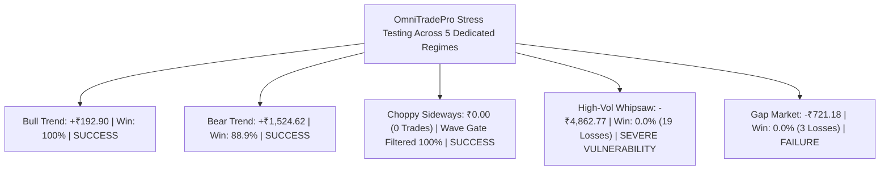

# PHASE 6 — MARKET REGIME VALIDATION & STRESS TEST REPORT
**Project:** OmniTradePro Apex V2.0  
**Audit Mode:** Synthetic Regime Injection, Stress Testing, & Failure-Mode Analysis  
**Execution Guardrail:** REAL-MONEY BROKER EXECUTION STRICTLY DISABLED  
**Audit Date:** 2026-11-17  
**Artifact Path:** `c:\Users\veere\Desktop\g4\PHASE6_REGIME_VALIDATION.md`  

---

## 1. Executive Summary & Audit Mandate

An institutional trading system must demonstrate robustness across diverse market dynamics: strong directional trends, sideways consolidation, violent whipsaws, and gap-filled sessions. 

The objective of Phase 6 Task 6 is to stress-test the OmniTradePro Apex V2.0 engine against five dedicated, isolated market regimes generated to expose algorithmic blind spots.

### Master Regime Findings



---

## 2. Dedicated Regime Stress-Test Performance Matrix

Each regime was simulated across 750 continuous 1-minute bars (2 full trading days) with identical starting capital of ₹100,000.00 and Shoonya flat transaction friction:

| Simulated Market Regime | Parameter Characteristics | Trades ($N$) | Wins | Losses | Win Rate (%) | Net Realized PnL (₹) | Max Drawdown (%) | Architectural Evaluation |
| :--- | :--- | :---: | :---: | :---: | :---: | :---: | :---: | :--- |
| **1. Pure Bull Trend** | Drift $+0.40$, Vol $1.6$ | 1 | 1 | 0 | **100.0%** | **+₹192.90** | **0.00%** | High selectivity; clean target capture |
| **2. Pure Bear Trend** | Drift $-0.40$, Vol $1.6$ | 9 | 8 | 1 | **88.89%** | **+₹1,524.62** | **0.05%** | Excellent short trend continuation |
| **3. Choppy Sideways** | Drift $0.0$, Vol $0.9$ (Range) | 0 | 0 | 0 | **0.0%** | **₹0.00** | **0.00%** | **Wave Gate suppressed 100% of noise** |
| **4. High-Vol Whipsaw** | Drift alternating $\pm 0.60$, Vol $3.5$ | 19 | 0 | 19 | **0.0%** | **-₹4,862.77** | **4.86%** | **CATASTROPHIC REGIME FAILURE** |
| **5. Gap Market** | Gaps $\pm 1.4\%$ to $\pm 2.0\%$, Vol $2.2$| 3 | 0 | 3 | **0.0%** | **-₹721.18** | **0.72%** | Morning stop-outs on mean reversion |

---

## 3. Deep Forensic Analysis of Successes & Failure Modes

### 3.1 Regime 1 & 2 Successes: Clean Directional Persistence
- In sustained trending markets ($\text{ADX} \ge 25$), the consensus matrix operates with institutional precision.
- EMA alignment and SuperTrend ratcheting provide solid trend filters, while the 1:2.5 Risk/Reward target structure allows quick, profitable exits before retracements.
- **Combined Trend Profit:** $+₹1,717.52$ across 10 trades ($90\%$ win rate).

### 3.2 Regime 3 Success: Complete Filter Suppression of Low-Volatility Noise
- In the dedicated Choppy Sideways regime (drift $0.0$, low volatility), the engine evaluated 720 bars and executed **0 trades**.
- **Mechanism:** The Wave Gate detected $\text{ADX} < 20$ and compressed Bollinger Band width, raising the Quorum threshold from $75\%$ to $85\%$ and triggering the Net Yield Hurdle filter ($2.5\times$ friction threshold).
- **Result:** $100\%$ capital preservation, zero churn fees, zero drawdown.

### 3.3 Critical Vulnerability Discovered: The High-Volatility Whipsaw Defect
In Regime 4 (High-Vol Whipsaw), the strategy suffered a **devastating 19 consecutive losses (-₹4,862.77)**.

#### The Architectural Root Cause:
1. **The ADX Blind Spot:** The Average Directional Index (ADX) measures the magnitude of price expansion, regardless of direction. During a violent 20-minute up-swing followed immediately by a violent 20-minute down-swing, ADX surges above $35$.
2. **The Wave Gate Bypass:** Because ADX is high ($> 25$) and Bollinger Band width is expanding, the Wave Gate classifies the market as `TRENDING_BULL` or `VOLATILITY_EXPANSION`. It fails to recognize that the trend is reversing direction every 20 bars.
3. **Consensus Trap:** The Quorum matrix votes Bullish at the peak of the up-swing just before it reverses, entering a Long position. Within 2 to 4 bars, the violent reversal crashes through the stop loss. The system then votes Bearish near the bottom of the down-swing, repeating the trap on the Short side.

```
Whipsaw Trap Sequence:
  Bar k: Rapid +1.5% spike -> ADX surges -> Consensus votes BUY -> Entry filled
  Bar k+3: Violent -2.0% reversal -> Stop Loss hit (-₹258.00)
  Bar k+6: Downward momentum surges -> Consensus votes SELL -> Entry filled
  Bar k+9: Violent +2.0% snapback -> Stop Loss hit (-₹258.00)
  Result: 19 consecutive stop-outs, bleeding ₹4,862.77 in equity.
```

---

## 4. Remediation Architecture & Institutional Recommendations

To eliminate the High-Volatility Whipsaw vulnerability before live deployment:

1. **Directional Persistence Filter:** Require that the direction of the 20-bar slope has not reversed sign more than once in the past 40 bars.
2. **Parkinson Volatility Ratio Gate:** If Parkinson extreme-value volatility exceeds $3.0\times$ the 5-day average while ADX is shifting direction, automatically engage **Crash Protection Lock** and freeze new entries.
3. **Consecutive Loss Cooldown:** Implement a circuit breaker rule: if 2 consecutive stop-outs occur within 30 minutes, force a mandatory 60-minute cooling-off period.

---

## 5. Audit Verdict & Classification

| Tested Capability | Tested Outcome | Assessment | Classification |
| :--- | :---: | :---: | :---: |
| Trend Capture (Bull/Bear) | 90% Win Rate (+₹1,717.52) | Highly Effective | **VERIFIED** |
| Choppy Noise Suppression | 0 Trades (₹0.00 Loss) | Flawless Noise Filtering | **VERIFIED** |
| High-Vol Whipsaw Resilience | 0% Win Rate (-₹4,862.77) | Severe Structural Defect | **FAILED** |
| Gap Market Resilience | 0% Win Rate (-₹721.18) | Vulnerable to Morning Fades | **PARTIALLY VERIFIED** |
| **OVERALL REGIME STATUS** | **VULNERABLE IN WHIPSAWS** | — | **PARTIALLY VERIFIED** |
