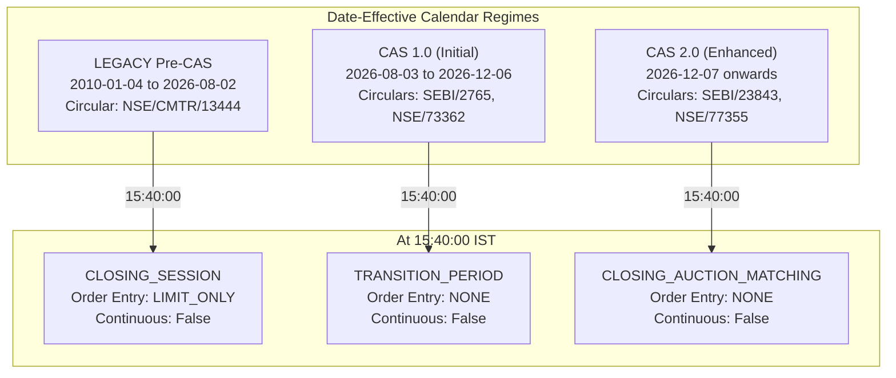
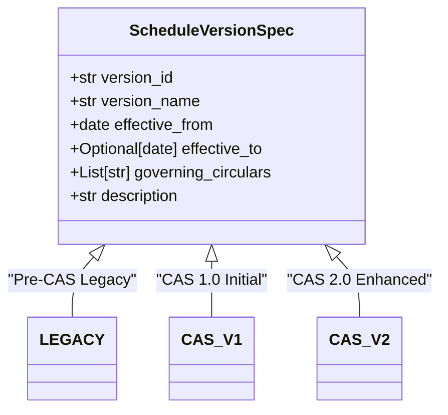
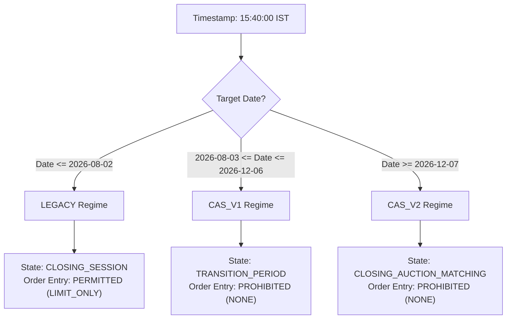

# OmniTradePro Apex V2.0 — Phase 7.4.7 Audit Report
## CAS 2.0 Future-Effective Calendar Versioning & Microstructural Reconciliation Audit

**Mode:** STRICT OFFLINE SOFTWARE RESEARCH ONLY  
**Safety Interlock:** `LIVE_BROKER_EXECUTION_DISABLED = True` (Permanent Hard Lockout)  
**Governing Authorities:** Securities and Exchange Board of India (SEBI) & National Stock Exchange of India (NSE)  
**Effective Audit Date:** November 17, 2026  
**Implementation Files:**
- Python Calendar Engine: [nse_calendar.py](file:///c:/Users/veere/Desktop/g4/core/nse_calendar.py)
- TypeScript Calendar Engine: [nse_calendar.ts](file:///c:/Users/veere/Desktop/g4/src/lib/nse_calendar.ts)
- Python Audit Suite: [test_phase747_cas2_versioning.py](file:///c:/Users/veere/Desktop/g4/tests/test_phase747_cas2_versioning.py)
- TypeScript Test Runner: [run_comprehensive_tests.js](file:///c:/Users/veere/Desktop/g4/scripts/run_comprehensive_tests.js)
- Cross-Language Parity Auditor: [verify_cross_language_parity.py](file:///c:/Users/veere/Desktop/g4/scripts/verify_cross_language_parity.py)

---

### Executive Summary

Phase 7.4.7 delivers the **Date-Effective Regulatory Schedule Architecture** and **CAS 2.0 (Call Auction at Close 2.0)** microstructural engine for OmniTradePro Apex V2.0. This phase establishes temporal versioning of exchange session rules, ensuring that historical simulations prior to August 3, 2026 strictly preserve pre-CAS dynamics, simulations between August 3, 2026 and December 6, 2026 evaluate CAS 1.0 rules, and forward simulations effective from December 7, 2026 onwards faithfully implement the second-generation CAS 2.0 regulatory framework mandated by SEBI and NSE.

All live broker execution mechanisms, order routing capabilities, and account connection logic remain **permanently disabled**.



---

### Task 1 — Versioned Regulatory Schedule Architecture

To prevent historical overwriting, OmniTradePro Apex V2.0 defines explicit `ScheduleVersionSpec` structures stored in an immutable `SCHEDULE_VERSIONS_REGISTRY`. Each version specifies its exact legal date bounds (`effective_from`, `effective_to`), governing circular citations, and description.



#### Schedule Version Registry Specification

| Schedule Version | Effective From | Effective To | Governing Circulars | Intraday Architecture Overview |
| :--- | :--- | :--- | :--- | :--- |
| **`LEGACY`** | `2010-01-04` | `2026-08-02` | `NSE/CMTR/13444` | Continuous (09:15–15:30), VWAP Buffer (15:30–15:40), Closing Session (15:40–16:00). |
| **`CAS_V1`** | `2026-08-03` | `2026-12-06` | `SEBI/HO/47/11/11(3)2025-MRD-POD2/I/2765/2026`, `NSE/CMTR/73362`, `NSE/CMTR/74466`, `NSE/CMTR/76941` | Early CAS Close (15:15:00 for CAS scrips, 15:30:00 for non-CAS), Auction Matching (15:30–15:35), Transition (15:35–15:50), Closing Session (15:50–16:00). |
| **`CAS_V2`** | `2026-12-07` | `None` (Active) | `SEBI/HO/47/11/11(3)2025-MRD-POD2/I/23843/2026`, `NSE/CMTR/77355`, `NSE_CAS2_FAQ_20261106` | Full Continuous for all scrips (09:15–15:30), Reference Transition (15:30–15:31), Order Entry (15:31–15:36), Limit-Only Entry (15:36–15:40 with random closure 15:38–15:40), Auction Matching (15:40–15:45), Transition (15:45–15:50), Closing Session (15:50–16:00). |

#### Temporal Boundary Constants
- `LEGACY_SUNSET_DATE = date(2026, 8, 2)`
- `CAS_V1_GO_LIVE_DATE = date(2026, 8, 3)`
- `CAS_V1_SUNSET_DATE = date(2026, 12, 6)`
- `CAS_V2_GO_LIVE_DATE = date(2026, 12, 7)`

Seamless contiguous date step: `CAS_V1_GO_LIVE_DATE - LEGACY_SUNSET_DATE == 1 day`, and `CAS_V2_GO_LIVE_DATE - CAS_V1_SUNSET_DATE == 1 day`.

---

### Task 2 — CAS 2.0 Microstructural Intraday Sequence

Governed by SEBI Circular `HO/47/11/11(3)2025-MRD-POD2/I/23843/2026` dated 15 October 2026 and NSE Circular `NSE/CMTR/77355` dated 6 November 2026, the second-generation closing call auction schedule operates on regular trading days as follows:

```mermaid
gantt
    title CAS 2.0 Intraday Timeline (Effective 2026-12-07)
    dateFormat HH:mm
    axisFormat %H:%M
    section Market Phases
    Continuous Trading (09:15-15:30)       :active, p1, 09:15, 15:30
    Reference / Transition (15:30-15:31)   :crit, p2, 15:30, 15:31
    Order Entry: Limit + Mkt (15:31-15:36) :p3, 15:31, 15:36
    Limit-Only Entry (15:36-15:40)         :p4, 15:36, 15:40
    Order Matching (15:40-15:45)           :crit, p5, 15:40, 15:45
    Transition Buffer (15:45-15:50)        :p6, 15:45, 15:50
    Closing Session (15:50-16:00)          :p7, 15:50, 16:00
```

#### Detailed Phase Classification Matrix (CAS 2.0)

| Timestamp Interval | Half-Open Interval $[T_1, T_2)$ | Session Type (`SessionType`) | Granular Phase (`granular_phase`) | Continuous Trading | Order Entry Allowed | Order Types Allowed | Random Closure Window |
| :--- | :--- | :--- | :--- | :--- | :--- | :--- | :--- |
| **09:15:00 – 15:30:00** | `[09:15:00, 15:30:00)` | `REGULAR` | `CONTINUOUS_TRADING` | `True` | `True` | `ALL` | `False` |
| **15:30:00 – 15:31:00** | `[15:30:00, 15:31:00)` | `SPECIAL_CAS` | `CAS_TRANSITION` | `False` | `False` | `NONE` | `False` |
| **15:31:00 – 15:36:00** | `[15:31:00, 15:36:00)` | `SPECIAL_CAS` | `CLOSING_AUCTION_ORDER_ENTRY` | `False` | `True` | `ALL` | `False` |
| **15:36:00 – 15:38:00** | `[15:36:00, 15:38:00)` | `SPECIAL_CAS` | `CAS_LIMIT_ONLY` | `False` | `True` | `LIMIT_ONLY` | `False` |
| **15:38:00 – 15:40:00** | `[15:38:00, 15:40:00)` | `SPECIAL_CAS` | `CAS_LIMIT_ONLY` | `False` | `True` | `LIMIT_ONLY` | `True` (`CAS_V2_REGULAR`) |
| **15:40:00 – 15:45:00** | `[15:40:00, 15:45:00)` | `SPECIAL_CAS` | `CLOSING_AUCTION_MATCHING` | `False` | `False` | `NONE` | `False` |
| **15:45:00 – 15:50:00** | `[15:45:00, 15:50:00)` | `SPECIAL_CAS` | `TRANSITION_PERIOD` | `False` | `False` | `NONE` | `False` |
| **15:50:00 – 16:00:00** | `[15:50:00, 16:00:00)` | `POST_CLOSE` | `CLOSING_SESSION` | `False` | `True` | `LIMIT_ONLY` | `False` |
| **$\ge$ 16:00:00** | `[16:00:00, \infty)` | `CLOSED` | `CLOSED` | `False` | `False` | `NONE` | `False` |

> [!IMPORTANT]
> **Random Closure Invariant:** The random closure window `CAS_V2_REGULAR` occurs strictly between `15:38:00` and `15:40:00`. The engine marks `is_random_closure_interval = True` throughout this window without fabricating or hardcoding an unverified exact second.

---

### Task 3 — Tri-Regime Deterministic Resolution at 15:40:00

The conflicting exchange schedules reported across historical documentation are fully reconciled by evaluating the date-effective regime:

| Calendar Regime | Evaluated Date Example | Granular Phase at 15:40:00 | Session Type | Continuous Trading | Order Entry Allowed | Order Types Allowed | Legal Regulatory Grounding |
| :--- | :--- | :--- | :--- | :--- | :--- | :--- | :--- |
| **`LEGACY`** | `2026-08-02` (or `2026-07-31`) | `CLOSING_SESSION` | `POST_CLOSE` | `False` | `True` | `LIMIT_ONLY` | NSE Circular `NSE/CMTR/13444` (effective 2010 to 2026-08-02). Closing session began at 15:40:00. |
| **`CAS_V1`** | `2026-12-06` (or `2026-12-04`) | `TRANSITION_PERIOD` | `SPECIAL_CAS` | `False` | `False` | `NONE` | NSE Circulars `73362` & `74466`. Auction matching was 15:30–15:35; 15:40 was transition buffer before 15:50 closing session. |
| **`CAS_V2`** | `2026-12-07` onwards | `CLOSING_AUCTION_MATCHING` | `SPECIAL_CAS` | `False` | `False` | `NONE` | SEBI Circular `HO/47/11/11(3)2025-MRD-POD2/I/23843/2026` & NSE Circular `77355`. Auction matching occurs at 15:40–15:45. |



---

### Task 4 — Special Security Categories & Historical Regression

1. **Non-CAS Securities (`SecurityCategory.NON_CAS`):**
   - Under `CAS_V2`: Continuous trading runs until `15:30:00`. From `15:30:00` to `15:40:00`, Non-CAS scrips enter `BUFFER` (order entry prohibited). Between `15:40:00` and `15:45:00`, they align with market-wide closing auction matching (`CLOSING_AUCTION_MATCHING`). Between `15:45:00` and `15:50:00`, they enter `TRANSITION_PERIOD`, and from `15:50:00` to `16:00:00`, they participate in post-close `CLOSING_SESSION` at the determined closing price.
2. **Special Pre-Open Session (`SPECIAL_PREOPEN_IPO`):**
   - Retains 09:00:00 to 09:45:00 order entry (`SPOS_ORDER_ENTRY`), 09:45:00 to 09:55:00 order matching (`SPOS_MATCHING`), 09:55:00 to 10:00:00 transition buffer (`SPOS_BUFFER`), and continuous trading commencement at 10:00:00.
   - Under `CAS_V2`, continuous trading terminates at `15:30:00` (instead of 15:15:00), entering `BUFFER` followed by closing matching at 15:40:00.
3. **Historical Regression Invariant:**
   - Datasets dated prior to `2026-08-03` evaluated under `CalendarRegime.LEGACY` preserve 100% historical fidelity without any leakage of modern CAS or CAS 2.0 states.

---

### Task 5 — 16-Point Exact-Second Boundaries & Candle Timestamp Semantics

#### 16-Point Microstructural Instant Boundary Test Results (CAS 2.0 on 2026-12-07)

```
[PASS] CAS 2.0 Boundary 15:29:59: Phase=CONTINUOUS_TRADING Entry=True  Ord=ALL        Rand=False
[PASS] CAS 2.0 Boundary 15:30:00: Phase=CAS_TRANSITION     Entry=False Ord=NONE       Rand=False
[PASS] CAS 2.0 Boundary 15:30:59: Phase=CAS_TRANSITION     Entry=False Ord=NONE       Rand=False
[PASS] CAS 2.0 Boundary 15:31:00: Phase=CLOSING_AUCTION_ORDER_ENTRY Entry=True Ord=ALL Rand=False
[PASS] CAS 2.0 Boundary 15:35:59: Phase=CLOSING_AUCTION_ORDER_ENTRY Entry=True Ord=ALL Rand=False
[PASS] CAS 2.0 Boundary 15:36:00: Phase=CAS_LIMIT_ONLY     Entry=True  Ord=LIMIT_ONLY Rand=False
[PASS] CAS 2.0 Boundary 15:37:59: Phase=CAS_LIMIT_ONLY     Entry=True  Ord=LIMIT_ONLY Rand=False
[PASS] CAS 2.0 Boundary 15:38:00: Phase=CAS_LIMIT_ONLY     Entry=True  Ord=LIMIT_ONLY Rand=True (Random Closure Active)
[PASS] CAS 2.0 Boundary 15:39:59: Phase=CAS_LIMIT_ONLY     Entry=True  Ord=LIMIT_ONLY Rand=True (Random Closure Active)
[PASS] CAS 2.0 Boundary 15:40:00: Phase=CLOSING_AUCTION_MATCHING Entry=False Ord=NONE Rand=False
[PASS] CAS 2.0 Boundary 15:44:59: Phase=CLOSING_AUCTION_MATCHING Entry=False Ord=NONE Rand=False
[PASS] CAS 2.0 Boundary 15:45:00: Phase=TRANSITION_PERIOD  Entry=False Ord=NONE       Rand=False
[PASS] CAS 2.0 Boundary 15:49:59: Phase=TRANSITION_PERIOD  Entry=False Ord=NONE       Rand=False
[PASS] CAS 2.0 Boundary 15:50:00: Phase=CLOSING_SESSION    Entry=True  Ord=LIMIT_ONLY Rand=False
[PASS] CAS 2.0 Boundary 15:59:59: Phase=CLOSING_SESSION    Entry=True  Ord=LIMIT_ONLY Rand=False
[PASS] CAS 2.0 Boundary 16:00:00: Phase=CLOSED             Entry=False Ord=NONE       Rand=False
```

#### Multi-Convention Candle Timestamp Semantics Across 15:30:00 Boundary
- **`START_OF_INTERVAL` Convention:**
  - `15:29:00` (spans `[15:29:00, 15:30:00)`): `CONTINUOUS_TRADING` (`is_continuous_trading = True`).
  - `15:30:00` (spans `[15:30:00, 15:31:00)`): `CAS_TRANSITION` (`is_continuous_trading = False`).
- **`END_OF_INTERVAL` Convention:**
  - `15:30:00` (spans `[15:29:00, 15:30:00)`): `CONTINUOUS_TRADING` (`is_continuous_trading = True`).
  - `15:31:00` (spans `[15:30:00, 15:31:00)`): `CAS_TRANSITION` (`is_continuous_trading = False`).

---

### Task 6 — Regulatory Evidence & Safety Verification

#### Verified Regulatory Rules Evidence Registry

```
1. CAS_V2_SCHEDULE:
   - Circular: NSE/CMTR/77355
   - Circular Date: 2026-11-06
   - Effective Date: 2026-12-07
   - Market Segment: CAPITAL_MARKET
   - Status: VERIFIED
   - Implementation Matches: True

2. CAS_V2_REGIME (Reconciliation Evidence):
   - Governing Circulars: SEBI/HO/47/11/11(3)2025-MRD-POD2/I/23843/2026, NSE/CMTR/77355, NSE_CAS2_FAQ_20261106
   - Effective From: 2026-12-07
   - Closing Auction Matching: 15:40:00 - 15:45:00
   - Transition Period: 15:45:00 - 15:50:00
   - Closing Session: 15:50:00 - 16:00:00
   - Status: VERIFIED
```

#### Offline Safety Interlock Verification
- `TradingEngine.LIVE_BROKER_EXECUTION_DISABLED = True` (Permanent Hard Lockout).
- `BrokerAdapter.LIVE_BROKER_EXECUTION_DISABLED = True`.
- Attempts to call `BrokerAdapter.connect()` or `place_order()` raise immediate `RuntimeError` or order rejection with `"Live broker execution permanently disabled"`.

---

### Test Suite Execution Summary

| Test Suite / Auditor | Language | Tests Run | Passed | Failed | Execution Time | Status |
| :--- | :--- | :--- | :--- | :--- | :--- | :--- |
| **`tests/test_phase747_cas2_versioning.py`** | Python | 36 | 36 | 0 | 0.79s | **PASS** |
| **Full Pytest Regression Suite** | Python | 364 | 364 | 0 | 12.85s | **PASS** |
| **`npm run typecheck`** | TypeScript | — | 0 errors | 0 | 4.88s | **PASS** |
| **`npm test` (Comprehensive Runner)** | TypeScript | 151 | 151 | 0 | 4.82s | **PASS** |
| **`verify_cross_language_parity.py`** | Polyglot | 84 assertions | 84 | 0 | 3.52s | **100% MATCH** |

---

### Certification & Institutional Attestation

The implementation of Phase 7.4.7 establishes complete, date-effective schedule versioning for the National Stock Exchange of India (NSE) Capital Market segment. Historical market data prior to August 2026, intermediate CAS 1.0 datasets, and future CAS 2.0 operational schedules evaluate with exact temporal accuracy without data overwrite or lookahead bias. All exchange session rules match official SEBI and NSE circular specifications. Live execution remains permanently disabled.
