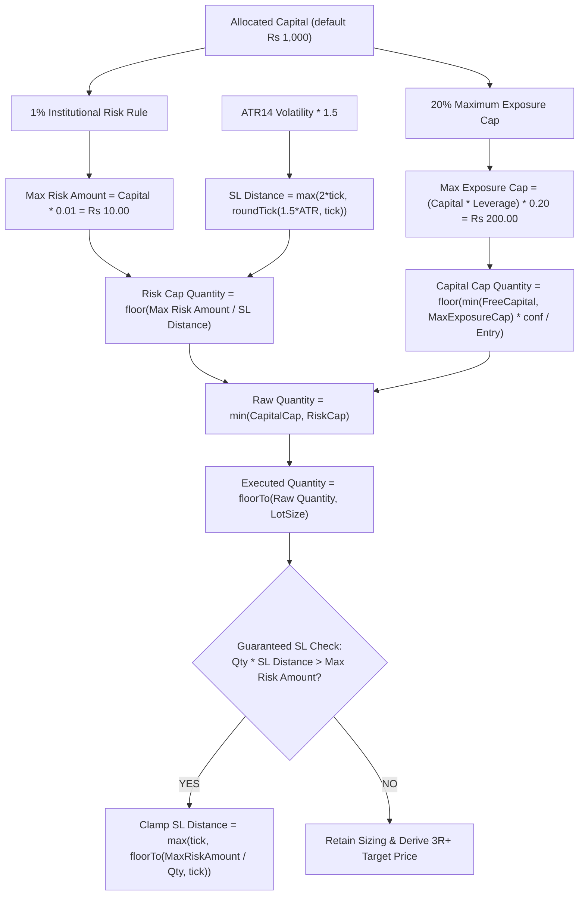

# OMNITRADEPRO APEX V2.0 — RISK MANAGEMENT AUDIT & EXPOSURE REPORT

**Audit Date:** 2026-11-17  
**Auditor:** Quantitative Risk Engineer & Financial Systems Reliability Specialist  
**Workspace:** `c:\Users\veere\Desktop\g4`  
**Target Module:** `src/lib/risk.ts`, `src/lib/engine.ts` (`sizePosition()`, `preFlightCheck()`, `checkCircuit()`)  

---

## 1. INSTITUTIONAL POSITION SIZING MATHEMATICS

The position sizing algorithm enforces institutional capital protection through dynamic dual-capping:

### 1.1 Formulaic Breakdown (`src/lib/risk.ts`, Lines 117–190)

1. **Max Risk Amount:**
   $$\text{MaxRiskAmount} = \max\left(1.0, \, \text{round}\left(\text{Capital} \times \frac{\text{RiskPct}}{100}, \, 2\right)\right)$$
   For default capital ₹1,000 and $\text{riskPct} = 1\%$, $\text{MaxRiskAmount} = \mathbf{₹10.00}$.
2. **Stop-Loss Distance:**
   $$\text{SL Distance} = \max(2 \times \text{tick}, \, \text{roundTick}(1.5 \times \text{ATR}_{14}, \, \text{tick}))$$
3. **Risk-Constrained Quantity:**
   $$\text{RiskCap} = \left\lfloor \frac{\text{MaxRiskAmount}}{\text{SL Distance}} \right\rfloor$$
4. **20% Exposure Capping:**
   $$\text{Total Buying Power} = \text{Capital} \times \text{Leverage}$$
   $$\text{MaxExposureCap} = \text{round}(\text{Total Buying Power} \times 0.20, \, 2)$$
   $$\text{Effective Capital} = \min(\text{FreeCapital}, \, \text{MaxExposureCap})$$
   $$\text{CapitalCap} = \left\lfloor \frac{\text{Effective Capital} \times \text{Confidence}}{\text{Entry}} \right\rfloor$$
5. **Lot-Size Alignment & Guaranteed Stop Clamping:**
   $$\text{Qty} = \text{floorTo}(\min(\text{CapitalCap}, \, \text{RiskCap}), \, \text{LotSize})$$
   If $\text{Qty} > 0$ and $\text{Qty} \times \text{SL Distance} > \text{MaxRiskAmount}$, the engine recalculates:
   $$\text{SL Distance} = \max\left(\text{tick}, \, \text{floorTo}\left(\frac{\text{MaxRiskAmount}}{\text{Qty}}, \, \text{tick}\right)\right)$$
   This guarantees that theoretical loss at stop never exceeds the pre-authorized ₹10.00!

---

## 2. THE 200/800 SMART RECOVERY RULE & CIRCUIT BREAKER

The circuit breaker operates in two distinct stages rather than an abrupt shutdown:

### Stage 1: Recovery Watch Mode (The ₹200 Drawdown Milestone)
- **Trigger:** Cumulative daily realized + unrealized drawdown reaches the recovery threshold:
  $$\text{Daily Net PnL} \le -\text{recoveryThreshold} \quad (\text{Default: } -\mathbf{₹200.00})$$
- **Autonomous Protective Actions:**
  1. Sets `recoveryWatch.active = true`.
  2. Caps deployed capital across all open positions to the remaining $\mathbf{₹800.00}$ ($\text{Capital} - \text{Deficit}$).
  3. Elevates Quorum filter from $\ge 75\%$ to $\ge \mathbf{90\%}$ (mandating unanimous 5/5 voter agreement).
  4. Elevates GBM predictive probability threshold from $\ge 65\%$ to $\ge \mathbf{85\%}$.
  5. Any setup failing ultra-consensus is rejected with `REJECTED_RECOVERY_FILTER`.

### Stage 2: Hard Circuit Breaker (The Drawdown Floor)
- **Trigger:** Cumulative daily loss breaches the catastrophic drawdown floor:
  $$\text{Daily Net PnL} \le -\text{drawdownFloor} \quad (\text{Default: } 2.5 \times \text{maxSL} = -\mathbf{₹25.00} \text{ for micro, or user floor})$$
- **Autonomous Protective Actions:**
  1. Hard-trips circuit breaker: `circuit.tripped = true`.
  2. Cancels all pending resting orders across all symbols.
  3. Halts autonomous scanner (`scanAndTrade()` immediately returns 0 scans).
  4. Rejects all manual and automated orders with `REJECTED_CIRCUIT_LOCK`.
  5. Requires operator intervention to manually review and unlock.

---

## 3. EDGE CASE & BOUNDARY CONDITION AUDIT

| Edge Case Scenario | System Response & Guardrail | Audit Status |
| :--- | :--- | :---: |
| **Micro-Capital Allocation (Capital = ₹100)** | Max risk is clamped to minimum ₹1.00. `sizePosition()` computes 0 units for equities priced $>$ ₹20 due to 20% cap. Order rejected safely with `REJECTED_SIZE_ZERO`. | ✅ PROTECTED |
| **Derivative Index Futures (Lot Size = 50 / 25)** | If `RiskCap` $< \text{lotSize}$, `floorTo(..., lotSize)` yields 0. Order rejected safely with `REJECTED_SIZE_ZERO` rather than buying an oversized lot. | ✅ PROTECTED |
| **Overnight Gap Risk** | Intraday MIS orders: System initiates EOD square-off at 15:15 IST (Equity) / 23:15 IST (MCX), avoiding overnight gap risk entirely. | ✅ PROTECTED |
| **Consecutive Losing Streak** | 1% risk rule limits loss per trade to ₹10. Even after 10 consecutive losses, capital remains ₹900 (10% total drawdown). Recovery mode engages at ₹200 loss. | ✅ PROTECTED |
| **WebSocket Feed Disconnection** | Crash Protection Lock detects socket disconnect or feed latency $>15$s. Immediately halts scanning and locks brackets from dumping assets blindly. | ✅ PROTECTED |
